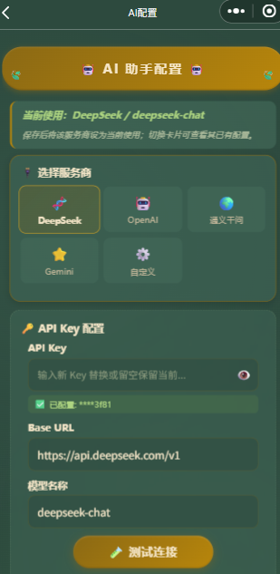
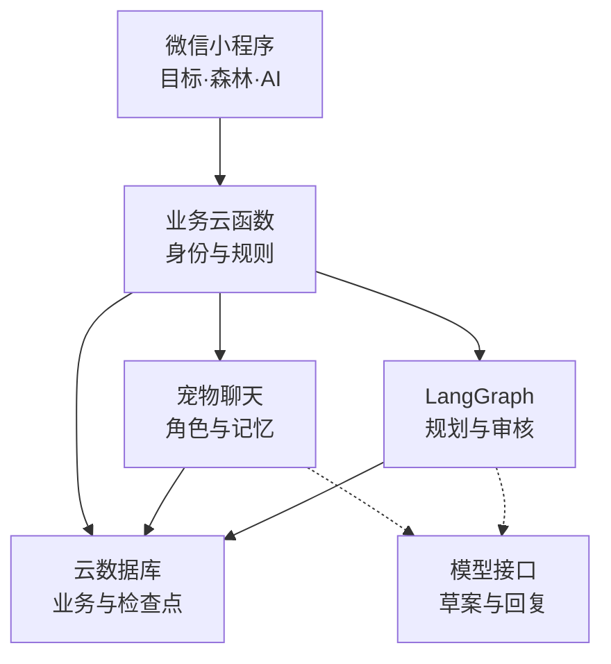
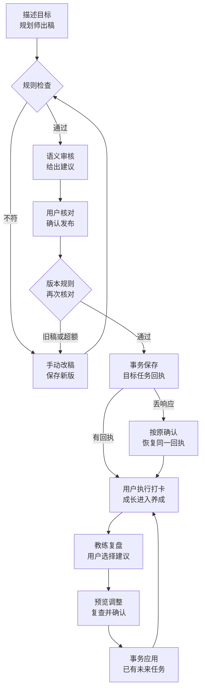
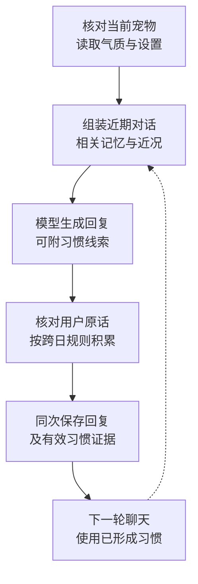

<div align="center">

# AI 自律森林

**多 Agent 目标管理与宠物陪伴养成微信小程序**

聊天规划 · 审核改稿 · 执行复盘 · 成长孵化 · 相处记忆

原生微信小程序 / TypeScript / LangGraph.js / Node.js 24 / CloudBase

[界面预览](#界面预览) · [功能全景](#已实现的功能) · [技术架构](#技术架构) · [业务工作流](#两条业务工作流) · [设计取舍](#设计理念与关键取舍) · [技术亮点](#技术亮点) · [快速开始](#快速开始)

</div>

## 项目解决什么问题

一份 AI 生成的学习计划，还需要具体任务、时间约束和执行后的调整。AI 自律森林面向学习、备考与习惯管理，把**目标描述、计划审核、用户确认、任务打卡和复盘调整**接入同一套业务流程。用户可以沿森林管家完成协作，也能独立使用规划师、审核师和教练。

宠物养成承接用户的努力。完成任务和签到积累的成长可用于灌注、孵化与身体阶段变化，宠物聊天则保留逐只相处的连续性。每只宠物复用已有先天气质，从初见开始建立自己的称呼、待续事项和后来学会的习惯。

**个人独立开发的本科毕业设计。** 我负责需求与交互设计、原生小程序、云函数与数据设计、Agent 工作流、宠物养成及部署联调。小程序已备案上传，当前供本人及授权同学使用。

**工程重点**是让模型建议进入可检查、可恢复的业务流程。草案换版后审核如何失效，发布丢响应后如何找回同一结果，复盘如何避免引用过期记录，以及宠物记忆如何核对来源，都有对应的代码与回归入口。

## 界面预览

**日常执行、AI 协作和宠物成长。** 首页集中显示签到、今日经验与任务，AI 页提供管家及专业伙伴入口，森林页展示宠物阶段和成长档案。

<p align="center">
  <a href="docs/showcase/images/home-checkin.png"></a>
  <a href="docs/showcase/images/ai-partners.png"></a>
  <a href="docs/showcase/images/pet-growth.png"></a>
</p>

*作者提供的微信开发者工具实拍，反映截取时的账号和页面状态。首页图保留签到成功提示，点击图片可查看原图。*

<details>
<summary>展开 AI 配置与管理后台</summary>

**AI 配置。** 支持 DeepSeek、OpenAI 等预设及自定义兼容接口，提供模型、Base URL 和连接测试。截图中的密钥使用掩码，实际可用模型取决于供应商配置。

<p align="center">
  <a href="docs/showcase/images/ai-settings.png"></a>
</p>

**管理后台。** 提供用户、宠物及反馈管理，由服务端核对管理员权限。图中的账号与统计卡用于说明界面，项目使用范围见文末。

<p align="center">
  <a href="docs/showcase/images/admin.png"></a>
</p>

</details>

## 已实现的功能

| 场景 | 已有能力与实现重点 |
| --- | --- |
| 目标与任务 | 手动创建目标、添加和排程任务，按日期筛选、打卡与完成目标。服务端核对周期、日期、任务归属及结算条件。 |
| 聊天规划与审核 | 聊天整理要求，主动生成可编辑草案。规则与语义意见分别呈现，问题可定位到任务，手改保存后复查新版本。 |
| 森林管家协作 | 组织规划、规则检查、语义审核及用户确认，保存步骤和检查点，发布后通过回执打开正式目标。 |
| 教练复盘与调整 | 按目标和日期读取执行事实与反馈，生成复盘建议。用户选一条建议带入调整，核对差异后事务修改已有未来任务。 |
| 森林与宠物养成 | 领蛋、成长灌注、孵化、互动、图鉴和成长档案。15 个物种、四个身体阶段，复用七种随机先天气质。 |
| 宠物陪伴聊天 | 选定具体宠物，查看角色卡、修改相处设置，保存确认的待续事项。按跨日证据学习安慰、庆祝和玩笑习惯。 |
| 日常工具与成长记录 | 番茄钟、今日任务抽签、心情记录、成就、成长日志及成长报告，复用已有任务或成长记录。 |
| 账号、配置与管理 | 登录会话、模型供应商配置与连接测试、客服和反馈入口，管理员处理用户、宠物及反馈。 |

功能表说明当前源码的实现范围。已备案上传版本、当前源码与云函数的配套状态，以及普通账号真机验收边界，见[验证与当前状态](#验证与当前状态)。

## 技术架构



实线表示业务调用或状态存取，虚线表示需要模型能力时的调用。教练复盘和任务调整由对应业务服务承接。专业伙伴入口复用同一批服务，宠物陪伴维护自己的会话与相处设置。

| 层次 | 技术与选型用途 |
| --- | --- |
| 原生页面 | JavaScript、WXML、WXSS、`wx.cloud`，沿用微信登录、页面和云开发能力。 |
| 协作编排 | TypeScript、LangGraph.js、持久化检查点。esbuild 生成适合现有云函数的 CommonJS 产物。 |
| 业务与数据 | Node.js 24、`wx-server-sdk`、CloudBase 文档数据库与事务，负责归属、版本、发布和成长结算。 |
| 模型适配 | 供应商预设和兼容接口配置，分别组装规划、审核、复盘与宠物聊天输入，并校验输出。 |
| 形象与界面状态 | 共用宠物立绘组件、物种与阶段配置，按账号维护草稿、待确认操作和页面恢复状态。 |
| 本地验证 | Node.js 断言、`node:test`、隔离云 SDK 传输，以及微信模板和样式编译检查。 |

**部署取舍。** 复用已有微信云函数，通过前台分段推进、检查点和运行状态保存协作。身份和业务写入统一经过服务端，模型输出先成为草案、意见或回复，再由相应规则及用户操作决定后续处理。

## 两条业务工作流

以「三天内每天学 20 分钟英语」为示例。规划师把目标整理成草案，审核师检查安排，用户改稿并确认后发布正式任务。打卡积累的成长可用于森林养成，宠物聊天承接日常陪伴。执行遇到困难时，教练根据记录提出调整建议，用户查看差异后决定是否应用。

### 目标执行工作流

在管家协作稿中明确设置每日 20 分钟硬上限，同日 25 分钟的安排会被规则检查拦截。保存新版后重新审核，发布前由后端复核当前版本。



发布结果未知时恢复原确认，重复请求返回同一回执。任务调整只处理明天起 7 天内、最多 20 项已有未完成任务。协作按步骤保存进度，用户离开后可在返回时主动继续。

### 宠物陪伴工作流

每只宠物从初见建立自己的聊天关系。身体阶段来自已有养成记录，表达方式由先天气质、手动设置和后来学会的习惯共同影响。



「留到下次」保存一件经主人确认的事项。安慰、庆祝和玩笑习惯从反复相处中积累，近 14 天内同一方向达到 3 个成功回合、跨至少 2 个北京时间日期才形成，主人可纠正或撤回。无效习惯线索会被忽略，正常回复仍可保存。

## 设计理念与关键取舍

- **把努力接到可见成长。** 规划、打卡和复盘帮助用户推进目标，已有经验与成长结算连接灌注和孵化，宠物陪伴延续日常相处。执行记录和聊天经历各自保留来源。
- **让协作和独立使用共用能力。** 森林管家维护一次目标协作的进度，规划师、审核师和教练也有独立入口。交接传递目标或草案引用，后端重新核对归属与版本。
- **明确模型与业务各自负责什么。** 规则代码计算日期、时长和成长，模型生成草案、语义意见和回复。用户确认正式变更，后端完成权限、版本及事务校验。

- **让陪伴从相处中形成。** 先天气质复用孵化记录，手动偏好、确认事项和反复学会的习惯各自保存，主人能查看、纠正或撤回。读取近况时只带入用户选中的相关事实。
- **共用表现配置，兼容已有宠物。** 物种和身体阶段继续使用既有身份与成长数据，立绘共用眨眼、局部动作和高天赋装饰配置。[形象组件](miniprogram/pet-art/portrait/) · [成长阶段配置](miniprogram/utils/shared/petStageConfig.js)

| 层次 | 当前实现与职责 |
| --- | --- |
| 协调流程 | 森林管家用 LangGraph 的预定义路由组织步骤、保存检查点、等待用户继续。 |
| 专业能力 | 规划师生成草案，审核师结合规则与语义意见检查，教练基于执行事实复盘。 |
| 业务执行 | Node.js 云函数核对身份、归属和规则，通过事务发布计划、调整任务与结算成长。 |
| 独立陪伴 | 宠物聊天按账号和宠物维护上下文，任务及喂食近况由用户选择带入。 |

当前协调采用代码驱动的有界流程。每次调用至多推进一次模型请求，分段保存状态，以适配现有云函数运行环境。页面关闭后当前请求可能完成，后续步骤由用户返回后继续。

## 技术亮点

### 1. LangGraph 检查点与分段恢复

规划、审核和确认跨越多次云函数请求。用 `StateGraph` 定义角色节点，以 `interrupt` 等待用户确认，自定义 `ForestSaver` 将检查点持久化。运行租约和步骤状态约束重复推进，用户重进可读取已保存进度。图工程打包为 CommonJS 产物，复用现有微信云函数和 SDK。

[图与检查点适配](agents/forest-steward/src/index.ts) · [运行状态与调度](cloudfunctions/app/lib/stewardRuns.js) · [构建入口](tools/build-steward.cjs) · [协作回归](tests/steward-workflow.cjs)

### 2. 规则审核、版本绑定与事务回执

手改后旧审核会失效，草案版本和指纹绑定要求、任务及审核结果。规则代码检查日期与时长，模型补充可执行性和递进建议。发布先保存原确认稿，再事务提交目标、任务和回执，超时重试可恢复同一结果，避免重复目标。签到与打卡也通过事务处理重复及并发结算。

[草案版本](cloudfunctions/app/lib/plannerDrafts.js) · [审核规则](cloudfunctions/app/lib/plannerReviewRules.js) · [发布事务](cloudfunctions/app/lib/planPublication.js) · [发布回归](tests/ai-publication-reliability.cjs) · [打卡回归](tests/checkin-reliability.cjs)

### 3. 带证据指纹的复盘调整

教练把目标、日期、执行事实和反馈绑定到证据指纹。建议通过引用交给调整流程，应用前重读来源、复查版本与规则，冲突时整批拒绝。用户确认差异后事务修改已有未来任务，保留执行历史和奖励，防止过期建议覆盖当前安排。

[事实计算](cloudfunctions/app/lib/coachFacts.js) · [调整草案](cloudfunctions/app/lib/adjustmentService.js) · [应用事务](cloudfunctions/app/lib/adjustmentApplication.js) · [应用回归](tests/adjustment-application.cjs)

### 4. 逐宠记忆与有来源的习惯形成

复用已有七种随机先天气质，按账号和宠物分别维护手动设置、近期对话、确认的待续事项及习惯。模型提出线索，服务端核对引用是否来自本轮用户原话，再按成功回合和北京时间日期去重积累。习惯记录保留来源与形成时间，支持纠正和撤回，让角色变化可以查看和解释。

[聊天上下文](cloudfunctions/app/lib/petChat.js) · [初见与习惯证据](cloudfunctions/app/lib/petChatGrowth.js) · [聊天回归](tests/pet-chat.cjs)

### 5. 稳定 Prompt 前缀与上下文预算

聊天将固定规则和角色资料前置，把本轮近况、相关待续放在动态输入段，并按固定顺序组织习惯。近期历史按回合数和字符预算裁剪，控制每轮上下文长度。供应商返回有效用量时记录缓存命中和输入 Token，便于后续测量效果。当前已实现前缀复用和统计校验，实际命中率与费用收益待实测。

[提示词与缓存用量处理](cloudfunctions/app/lib/petChat.js) · [稳定前缀及统计边界回归](tests/pet-chat.cjs) · [实现记录](docs/PET_INTEGRATION_READINESS.md)

## 代码阅读路线

| 想了解什么 | 建议入口 |
| --- | --- |
| 协作如何暂停和恢复 | [图与保存器](agents/forest-steward/src/index.ts) → [运行服务](cloudfunctions/app/lib/stewardRuns.js) → [工作流回归](tests/steward-workflow.cjs) |
| 计划怎样从建议变成正式任务 | [草案版本](cloudfunctions/app/lib/plannerDrafts.js) → [审核规则](cloudfunctions/app/lib/plannerReviewRules.js) → [发布事务](cloudfunctions/app/lib/planPublication.js) |
| 复盘怎样关联未来调整 | [事实整理](cloudfunctions/app/lib/coachFacts.js) → [调整草案](cloudfunctions/app/lib/adjustmentService.js) → [整批应用](cloudfunctions/app/lib/adjustmentApplication.js) |
| 一只宠物怎样记住相处方式 | [聊天服务](cloudfunctions/app/lib/petChat.js) → [初见与习惯](cloudfunctions/app/lib/petChatGrowth.js) → [客户端工作区](miniprogram/utils/petChatWorkspace.js) |
| 各物种怎样共用形象能力 | [立绘选择](miniprogram/utils/petPortrait.js) → [动画组件](miniprogram/pet-art/portrait/) → [身体阶段](miniprogram/utils/shared/petStageConfig.js) |
| 身份与数据怎样进入业务 | [云调用](miniprogram/utils/cloudApi.js) → [登录函数](cloudfunctions/login/index.js) → [业务入口](cloudfunctions/app/index.js) |

## 快速开始

准备 Git、Node.js **24.x**（`.nvmrc` 固定 `24.22.2`）和微信开发者工具。当前实现以 `codex/forest-current-snapshot` 分支为入口。

```powershell
git clone https://github.com/666whatcanisay/WXshengling.git
cd WXshengling
git switch codex/forest-current-snapshot
npm ci
npm ci --prefix cloudfunctions/app --ignore-scripts
npm run verify
```

这组命令安装依赖并运行隔离业务回归。体验真实微信登录、数据库和模型功能时，需要连接自己的微信云开发环境。

1. 在微信开发者工具中导入仓库根目录，配置 `project.config.json` 的 AppID。
2. 在[云环境配置](miniprogram/utils/cloudConfig.js)中设置自己有权限访问的环境和函数名。
3. 按[云开发接入与权限说明](docs/NODE24_CLOUD_PREFLIGHT.md)准备数据库、权限与配套函数。源码目录 `cloudfunctions/app`、`cloudfunctions/login` 对应当前客户端的 `app-node24`、`login-node24`。
4. 在「我的 → AI 配置」设置供应商，通过连接测试后，从「AI → 森林管家」体验协作，或进入宠物聊天。

<details>
<summary>修改 Agent 图与检查微信模板</summary>

修改图源码后安装图工程依赖并重建。已有产物随源码保存，读取和运行既有业务可以直接使用该产物。

```powershell
npm ci --prefix agents/forest-steward
npm run build:steward
```

`npm run verify:ui` 调用本机微信编译器，位置可通过 `WECHAT_DEVTOOLS_DIR` 配置。它检查页面注册、模板和样式，原生交互仍需在开发者工具或手机中核对。

</details>

## 验证与当前状态

| 范围 | 已有依据与边界 |
| --- | --- |
| 使用与备案 | 作者确认已备案上传，供本人及授权同学使用。公开仓库提供源码与开发截图。 |
| 离线回归 | 2026-11-11 记录包含 `npm run verify` 通过。覆盖草案换版、发布重试、并发打卡、来源冲突、账号切换和宠物会话隔离等场景。 |
| 微信编译 | 同日记录包含 22 份 WXML 与 23 份 WXSS 编译检查。编译结果用于说明模板与样式可编译。 |
| 云端及真机 | 历史记录核对了 Node24 云函数，当前工作区仍包含晚于云端的修复。最新配套版本的普通账号真机全流程待统一验收。 |
| 模型与效果 | 实际回复质量、缓存命中率和费用收益待实测。项目暂未开展证明长期自律效果的用户研究。 |

测试覆盖范围和历史记录按日期阅读，当前实现详见[项目状态](docs/CURRENT_STATE.md)与[开发文档导航](docs/README.md)。

## 进一步阅读

| 文档 | 内容 |
| --- | --- |
| [管家工作流](docs/FOREST_STEWARD_WORKFLOW.md) | LangGraph 接入、检查点、分段执行和云函数约束 |
| [草案基础](docs/PLANNER_DRAFT_FOUNDATION.md) / [计划审核](docs/PLANNER_REVIEW.md) | 要求来源、草案换版、规则及语义意见 |
| [教练复盘](docs/COACH_REVIEW.md) / [调整事务](docs/TASK_ADJUSTMENT_APPLY.md) | 执行证据、建议交接、确认与整批应用 |
| [宠物聊天与相处](docs/PET_INTEGRATION_READINESS.md) | 角色卡、初见、逐宠记忆、习惯和验证边界 |
| [宠物系统基线](docs/PET_SYSTEM_BASELINE.md) | 物种、身体阶段、已有数据格式和形象配置 |
| [当前实现](docs/CURRENT_STATE.md) / [开发文档入口](docs/README.md) | 功能入口、历史验证与本地和云端边界 |

## 数据与许可

真实业务记录保存在作者自己的云开发环境中，复现时使用自己的账号、数据库与模型配置。API Key 和登录凭据通过配置管理，个人开发者工具配置、依赖与本机凭据由 `.gitignore` 排除。截图反映作者提供的页面状态，管理统计用于说明界面。

仓库目前未附开源许可证。代码与宠物素材的使用授权请与作者确认。