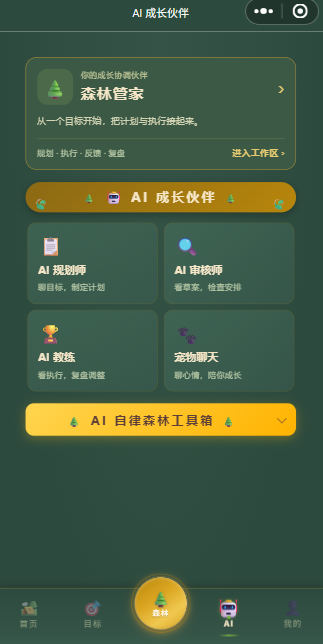
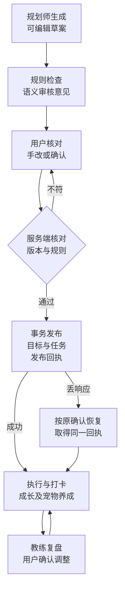
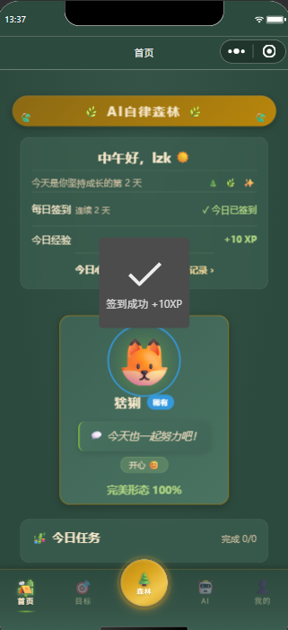

<div align="center">

# AI 自律森林

**AI 目标规划与宠物陪伴养成微信小程序**

LangGraph · TypeScript · Node.js 24 · CloudBase

[产品流程](#从一个学习目标开始) · [核心设计](#核心工程设计) · [代码入口](#技术栈与代码入口) · [运行与验证](#运行与验证)

</div>

面向学习、备考和习惯管理，通过 AI 协作把目标变成可执行任务。打卡积累的成长用于领蛋、灌注和孵化，日常聊天让每只宠物逐渐形成自己的相处习惯。

我独立完成需求与交互设计、原生小程序、云函数、Agent 工作流、宠物养成及部署联调。项目为本科毕业设计，已备案上传，当前供本人及授权同学使用。

- **Agent 协作执行**：LangGraph 编排规划与审核，经版本校验和用户确认后事务发布，支持协作进度恢复和丢回执重试。[查看工作流源码](agents/forest-steward/src/index.ts)
- **宠物陪伴养成**：任务成长连接孵化与养成，聊天按宠物隔离角色和记忆，从有来源的跨日互动中学习相处习惯。[查看聊天与记忆实现](cloudfunctions/app/lib/petChat.js)

<p align="center">
  <a href="docs/showcase/images/ai-partners.png"></a>
  <a href="docs/showcase/images/pet-growth.png"></a>
</p>

*AI 伙伴入口与宠物成长档案。作者提供的微信开发者工具实拍，反映截取时的页面状态，点击可查看原图。*

## 从一个学习目标开始

以「三天内每天学 20 分钟英语」为示例。规划师生成草案，在管家协作稿中设置每日 20 分钟硬上限，同日 25 分钟的安排会被规则检查拦截。用户定位问题、手改保存、复查确认后发布正式任务。打卡结算的成长可用于森林养成，宠物聊天延续彼此的相处经历。执行遇到困难时，教练依据记录复盘，用户选建议、看差异并确认后调整已有未来任务。

<details>
<summary>展开完整流程与异常恢复</summary>



管家采用预定义路由和状态控制，分别组织规划、规则检查、语义审核和人工确认。模型提出草案与建议，服务端校验和用户操作决定正式写入。当前流程由用户在页面中主动推进，调整范围为明天起 7 天内、最多 20 项已有未完成任务。

</details>

## 核心工程设计

### 可恢复的 Agent 工作流

规划和审核跨越多次云函数请求。用 `StateGraph` 定义角色节点，以 `interrupt` 等待用户确认，自定义 `ForestSaver` 持久化检查点。运行租约约束重复推进，用户返回后可继续读取已保存进度。

[图与检查点适配](agents/forest-steward/src/index.ts) · [角色调度与运行状态](cloudfunctions/app/lib/stewardRuns.js) · [验证记录](docs/FOREST_STEWARD_WORKFLOW.md)

### 版本审核与可靠写入

手改后旧审核会失效，草案版本与内容指纹绑定要求、任务和审核结果。代码检查日期、时长和明确设置的上限，模型补充语义意见。后端复查后事务提交目标、任务及回执，丢响应按原确认恢复，重复请求返回同一结果。

[草案版本](cloudfunctions/app/lib/plannerDrafts.js) · [审核规则](cloudfunctions/app/lib/plannerReviewRules.js) · [发布事务](cloudfunctions/app/lib/planPublication.js) · [发布回归](tests/ai-publication-reliability.cjs)

### 有证据的复盘与调整

教练把目标、日期、执行事实和反馈绑定到证据指纹。建议通过引用交给调整流程，应用前重读来源并复查规则，冲突时整批拒绝。用户确认差异后事务修改已有未来任务，保留执行历史和奖励。

[事实计算](cloudfunctions/app/lib/coachFacts.js) · [调整草案](cloudfunctions/app/lib/adjustmentService.js) · [应用事务](cloudfunctions/app/lib/adjustmentApplication.js)

### 逐宠隔离的角色与相处记忆

复用七种随机先天气质，按账号和宠物保存手动设置、近期对话、确认的待续事项及习惯。模型提出的习惯线索须引用用户原话，近 14 天内积累 3 个成功回合、跨至少 2 个北京时间日期后形成，可纠正或撤回。首版学习安慰、庆祝和玩笑分寸，任务及喂食近况由用户选入。

[聊天上下文](cloudfunctions/app/lib/petChat.js) · [初见与习惯证据](cloudfunctions/app/lib/petChatGrowth.js) · [实现说明](docs/PET_INTEGRATION_READINESS.md)

<details>
<summary>展开首页、AI 配置与管理后台截图</summary>

**首页。** 签到、今日经验、宠物轮播和任务集中展示，截图保留了签到成功提示。森林提供 15 个物种的四阶段形象，共用基础动画和高天赋装饰配置。

<p align="center">
  <a href="docs/showcase/images/home-checkin.png"></a>
</p>

**AI 配置。** 支持 DeepSeek、OpenAI 等预设及自定义兼容接口，提供模型、Base URL 和连接测试，密钥以掩码显示。实际可用模型取决于供应商配置。

<p align="center">
  <a href="docs/showcase/images/ai-settings.png"></a>
</p>

**管理后台。** 提供用户、宠物和反馈管理，由服务端检查管理员权限。统计卡用于说明界面。

<p align="center">
  <a href="docs/showcase/images/admin.png"></a>
</p>

</details>

## 技术栈与代码入口

- **客户端**：原生 JavaScript、WXML、WXSS，`wx.cloud` 调用云函数。[AI 伙伴](miniprogram/pages/ai/) · [森林管家](miniprogram/pages/forest-steward/) · [宠物页](miniprogram/pages/pets/)
- **AI 与业务后端**：TypeScript、LangGraph.js、Node.js 24、`wx-server-sdk`、CloudBase 文档数据库与事务。[图源码](agents/forest-steward/src/index.ts) · [业务服务](cloudfunctions/app/lib/) · [身份与业务入口](cloudfunctions/app/index.js)
- **验证**：Node.js 断言与 `node:test`，隔离云 SDK 传输，微信开发者工具编译器检查模板和样式。[业务回归](tests/) · [界面检查](tools/verify-ui.cjs) · [开发文档](docs/README.md)

## 运行与验证

**使用情况。** 已备案上传，当前供本人及授权同学使用。仓库为私有，查看和克隆需要账号访问权限。

**验证记录。** 2026-11-11 记录包含 `npm run verify` 通过、22 份 WXML 和 23 份 WXSS 编译检查，以及 Node24 云函数核对。当前工作区包含晚于云端的修复，最新源码与配套云函数的普通账号真机全流程、模型回复质量及缓存命中率待统一实测。[查看实现与验证边界](docs/CURRENT_STATE.md)

<details>
<summary>展开本地运行与环境配置</summary>

准备 Git、Node.js **24.x**（`.nvmrc` 固定 `24.22.2`）和微信开发者工具。当前实现以 `codex/forest-current-snapshot` 分支为入口。

```powershell
git clone https://github.com/666whatcanisay/WXshengling.git
cd WXshengling
git switch codex/forest-current-snapshot
npm ci
npm ci --prefix cloudfunctions/app --ignore-scripts
npm run verify
```

`verify` 使用隔离传输替身检查本地业务逻辑。真实微信登录、数据库和模型体验需连接自己的开发环境。

在微信开发者工具中导入仓库根目录，配置 `project.config.json` 的 AppID 和[云环境与函数映射](miniprogram/utils/cloudConfig.js)。源码目录 `cloudfunctions/app`、`cloudfunctions/login` 对应当前客户端的 `app-node24`、`login-node24`。按[云开发接入与权限说明](docs/NODE24_CLOUD_PREFLIGHT.md)准备数据库和配套函数，在「我的 → AI 配置」设置供应商，再从「AI → 森林管家」进入协作。

修改 Agent 图时安装图工程依赖并重建，已有构建产物随源码保存。

```powershell
npm ci --prefix agents/forest-steward
npm run build:steward
```

`npm run verify:ui` 调用本机微信编译器，位置可通过 `WECHAT_DEVTOOLS_DIR` 配置。

</details>

## 数据与许可

真实业务记录保存在作者自己的云开发环境中，复现时使用自己的账号、数据库与模型配置。API Key 和登录凭据通过配置管理，个人工具配置与本机凭据由 `.gitignore` 排除。

仓库目前未附开源许可证。代码与宠物素材的使用授权请与作者确认。
