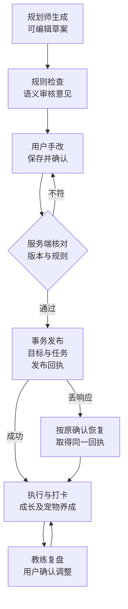
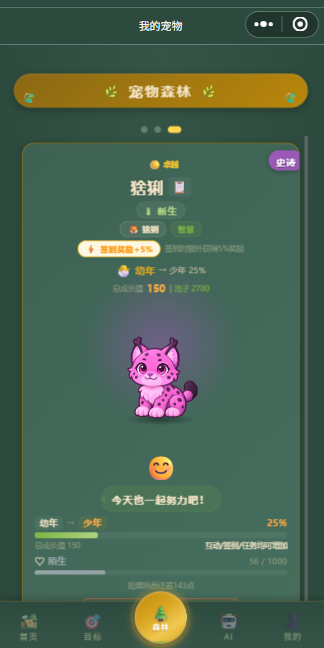
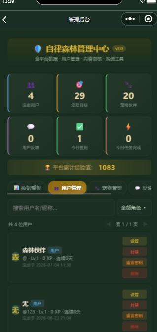

<div align="center">

# AI 自律森林

**用 AI 协作拆解目标，把每天的努力积累成宠物成长与陪伴。**

微信小程序 · 分层多 Agent 协作 · LangGraph · CloudBase

[使用流程](#从一个学习目标开始) · [技术设计](#值得深入看的五个设计) · [产品截图](#森林里的成长) · [本地运行](#本地运行)

</div>

面向学习、备考和日常习惯管理，用户可以通过聊天制定计划，经审核、改稿和确认后生成正式任务。完成任务与签到积累成长，用于领蛋、灌注和孵化；宠物聊天则让每只伙伴逐渐形成自己的相处习惯。执行遇到困难时，教练根据真实记录复盘，用户确认后调整后续任务。

**个人独立开发的本科毕业设计。** 我负责需求与交互设计、原生小程序、云函数与数据设计、Agent 工作流、宠物养成和开发联调。小程序已备案上传，当前供本人及授权同学使用。

<p align="center">
  <a href="docs/showcase/images/ai-partners.png"></a>
</p>

*作者提供的微信开发者工具实拍。森林管家组织协作，各伙伴也保留独立入口。截图反映截取时的页面状态，点击可查看原图。*

## 从一个学习目标开始

以「三天内，每天安排 20 分钟英语学习」为例。以下是说明流程的示例输入。

1. **聊清目标。** 在规划师中补充周期、可用时间和约束，随时主动结束补充并生成草案。
2. **审核并手动改稿。** 若在管家协作稿中明确设置「每天最多 20 分钟」，同日安排 25 分钟会被规则检查拦截。审核问题可定位到具体任务，保存新版后重新检查。
3. **确认后发布。** 后端校验当前已保存版本，把目标、任务与回执在同一事务中写入，管家可凭回执打开对应目标。
4. **执行获得成长。** 用户打卡或签到后由后端结算，成长进入已有的森林养成路径，宠物经历从蛋到孵化、再到不同身体阶段。
5. **依据执行记录调整。** 教练按所选目标和日期读取事实，用户可选择一条建议带入调整。确认差异后，只修改明天起 7 天内、最多 20 项已有未完成任务。



管家的协调层采用预定义路由和状态控制，LangGraph 编排规划、规则检查、语义审核及等待用户确认。模型提出草案与建议，服务端校验和用户操作决定何时写入正式数据。当前流程由用户在页面中主动推进。

## 值得深入看的五个设计

### 1. 可以暂停、恢复的 Agent 协作

规划和审核跨越多次请求，云函数进程结束后还需要继续。管家用 LangGraph 的 `StateGraph` 定义角色节点，通过 `interrupt` 停在待确认处，自定义 `ForestSaver` 将检查点交给云数据库持久化；运行记录再用租约和状态校验约束重复推进。这样可以逐步展示协作进度，并在用户返回时读取已保存状态。

[图定义与检查点适配](agents/forest-steward/src/index.ts) · [运行状态与角色调度](cloudfunctions/app/lib/stewardRuns.js) · [实现与验证记录](docs/FOREST_STEWARD_WORKFLOW.md)

### 2. 绑定具体版本的计划审核

任务改过后，先前的审核结论可能已经过期。草案用版本和内容指纹关联要求、任务与审核结果；规则代码计算日期、时长和管家协作稿的每日硬上限，模型补充可执行性与递进建议。手动保存新稿会使旧审核失效，发布时服务端再次核对已保存版本，避免仅凭页面上的旧结论发布。独立规划师沿用自己的提醒与发布流程。

[草案保存与版本](cloudfunctions/app/lib/plannerDrafts.js) · [规则与语义结果校验](cloudfunctions/app/lib/plannerReviewRules.js) · [审核设计](docs/PLANNER_REVIEW.md)

### 3. 发布和打卡的重复请求处理

移动网络下，超时可能发生在服务端已经写入之后。发布先保存原确认稿，再以稳定请求标识和内容指纹恢复，同一事务提交目标、任务及回执；重复确认返回已有结果。打卡也通过事务和结算记录处理重复与并发请求，让页面恢复和后端写入保持一致。

[计划发布事务与回执](cloudfunctions/app/lib/planPublication.js) · [打卡与成长结算](cloudfunctions/app/index.js) · [发布回归](tests/ai-publication-reliability.cjs) · [打卡回归](tests/checkin-reliability.cjs)

### 4. 有来源依据的复盘与任务调整

历史复盘引用的任务可能已经改变。教练把目标、日期、执行事实和用户反馈绑定到证据指纹，选中的建议通过引用传给调整流程；应用前重读来源、复查版本与规则，任一来源冲突时整批拒绝。用户先看差异再确认，正式应用只修改已有未来任务的名称、日期和预计时长，保留历史执行与奖励记录。

[复盘事实计算](cloudfunctions/app/lib/coachFacts.js) · [建议与调整草案](cloudfunctions/app/lib/adjustmentService.js) · [整批事务应用](cloudfunctions/app/lib/adjustmentApplication.js)

### 5. 每只宠物有自己的角色和相处记忆

同一账号下有多只宠物，角色、称呼和约定需要分别保存。聊天按账号和宠物隔离，将先天气质、手动设置、近期对话、确认的「留到下次」事项和学会的习惯分别维护。模型提出的习惯线索需引用本轮用户原话；近 14 天内，同一方向积累 3 个成功回合并跨至少 2 个北京时间日期，才形成可纠正、可撤回的习惯。当前学习范围是安慰、庆祝和玩笑分寸。

宠物角色复用森林里的七种随机先天气质和真实成长档案。任务、喂食等近况由用户选择带入，聊天依据选入的事实回应。

[宠物聊天与上下文组装](cloudfunctions/app/lib/petChat.js) · [初见、气质与习惯证据](cloudfunctions/app/lib/petChatGrowth.js) · [宠物聊天实现记录](docs/PET_INTEGRATION_READINESS.md)

## 森林里的成长

**首页与养成档案。** 签到、今日经验和任务集中展示；成长进入森林后可用于灌注、孵化。已有 15 个物种的四阶段形象，共用眨眼、局部动作和高天赋装饰配置。

<p align="center">
  <a href="docs/showcase/images/home-checkin.png"></a>
  <a href="docs/showcase/images/pet-growth.png"></a>
</p>

*首页图保留了签到成功提示，宠物图展示已有成长档案。身体成长与聊天中学会的相处习惯分别记录。*

<details>
<summary>展开 AI 配置与管理后台</summary>

**AI 配置。** 支持 DeepSeek、OpenAI 等预设和自定义兼容接口，页面提供模型名、Base URL 与连接测试；截图中的密钥以掩码显示。具体可用模型取决于配置和供应商接口。

<p align="center">
  <a href="docs/showcase/images/ai-settings.png"></a>
</p>

**管理后台。** 提供用户、宠物与反馈管理，入口受服务端管理员权限校验。

<p align="center">
  <a href="docs/showcase/images/admin.png"></a>
</p>

*统计卡用于说明后台界面，项目的实际使用范围见下文。*

</details>

## 技术栈与代码入口

- **客户端**：原生微信小程序，JavaScript、WXML、WXSS，`wx.cloud` 调用云函数。
- **AI 工作流**：TypeScript、LangGraph.js，构建为随业务云函数运行的 CommonJS 产物；规划、审核、复盘分别组装输入和校验输出。
- **业务后端**：Node.js 24、`wx-server-sdk`、CloudBase 文档数据库与事务。身份、归属、规则和成长结算在服务端处理。
- **本地验证**：Node.js 断言与 `node:test`，隔离云 SDK 传输；微信模板和样式可通过本机开发者工具编译器检查。

| 想了解什么 | 从这里看 |
| --- | --- |
| 页面与伙伴入口 | [AI 成长伙伴](miniprogram/pages/ai/) · [森林管家](miniprogram/pages/forest-steward/) · [宠物页](miniprogram/pages/pets/) |
| 请求、身份与业务分发 | [客户端云调用](miniprogram/utils/cloudApi.js) · [业务云函数](cloudfunctions/app/index.js) · [登录云函数](cloudfunctions/login/index.js) |
| Agent 图与业务服务 | [TypeScript 图源码](agents/forest-steward/src/index.ts) · [服务模块](cloudfunctions/app/lib/) |
| 草案、发布和调整的设计取舍 | [草案基础](docs/PLANNER_DRAFT_FOUNDATION.md) · [审核](docs/PLANNER_REVIEW.md) · [调整事务](docs/TASK_ADJUSTMENT_APPLY.md) |
| 回归与界面检查 | [业务测试](tests/) · [界面检查工具](tools/verify-ui.cjs) |

## 本地运行

准备 Git、Node.js **24.x**（`.nvmrc` 固定 `24.22.2`）和微信开发者工具。当前实现位于 `codex/forest-current-snapshot` 分支，先切换分支，再在终端运行隔离回归。

```powershell
git clone https://github.com/666whatcanisay/WXshengling.git
cd WXshengling
git switch codex/forest-current-snapshot
npm ci
npm ci --prefix cloudfunctions/app --ignore-scripts
npm run verify
```

私有仓库的克隆需要账号访问权限。`verify` 检查 Node 主版本并运行本地业务回归，采用隔离传输替身；这一步可以检查业务逻辑，真实微信登录和模型体验需在小程序中验证。

在微信开发者工具中导入仓库根目录。连接自己的开发环境时，将 `project.config.json` 的 AppID、[云配置](miniprogram/utils/cloudConfig.js) 中的环境与函数名称改为自己有权限访问的配置，按[云开发接入与权限说明](docs/NODE24_CLOUD_PREFLIGHT.md)准备数据库和配套函数。源码目录 `cloudfunctions/app`、`cloudfunctions/login` 对应当前客户端的 `app-node24`、`login-node24`，部署时需核对名称。进入「我的 → AI 配置」设置供应商，再从「AI → 森林管家」体验协作。

需要修改 Agent 图时，安装图工程依赖并重新构建。

```powershell
npm ci --prefix agents/forest-steward
npm run build:steward
```

`npm run verify:ui` 可调用本机微信编译器做模板、样式检查，编译器位置可通过 `WECHAT_DEVTOOLS_DIR` 配置。已有构建产物随源码保存，查看或运行既有业务无需先改图。

## 完成程度与验证依据

| 范围 | 当前依据与边界 |
| --- | --- |
| 产品使用 | 作者确认已备案上传，当前供本人及授权同学使用。 |
| 代码实现 | 当前源码包含规划、审核改稿、事务发布、执行成长、教练调整、宠物聊天与管理入口。 |
| 本地验证 | 2026-11-11 验证记录包含 `npm run verify`、22 份 WXML 和 23 份 WXSS 编译检查；断言与测试按各自口径记录。 |
| 云端与真机 | 同日记录核对了 Node24 云函数，但当前工作区还包含部分晚于云端的修复；最新源码的普通账号真机全流程、模型回复质量及缓存命中率仍待统一实测。 |

[现状与验证边界](docs/CURRENT_STATE.md) · [协作流程记录](docs/FOREST_STEWARD_WORKFLOW.md) · [开发文档导航](docs/README.md)

## 数据与许可

仓库提供源码和开发截图。真实业务记录保存在作者自己的云开发环境中，复现时使用自己的账号、数据库与模型配置；API Key 和登录凭据通过配置管理。个人开发者工具配置、依赖和本机凭据由 `.gitignore` 排除。

仓库目前未附开源许可证。代码与宠物素材的使用授权请与作者确认。
