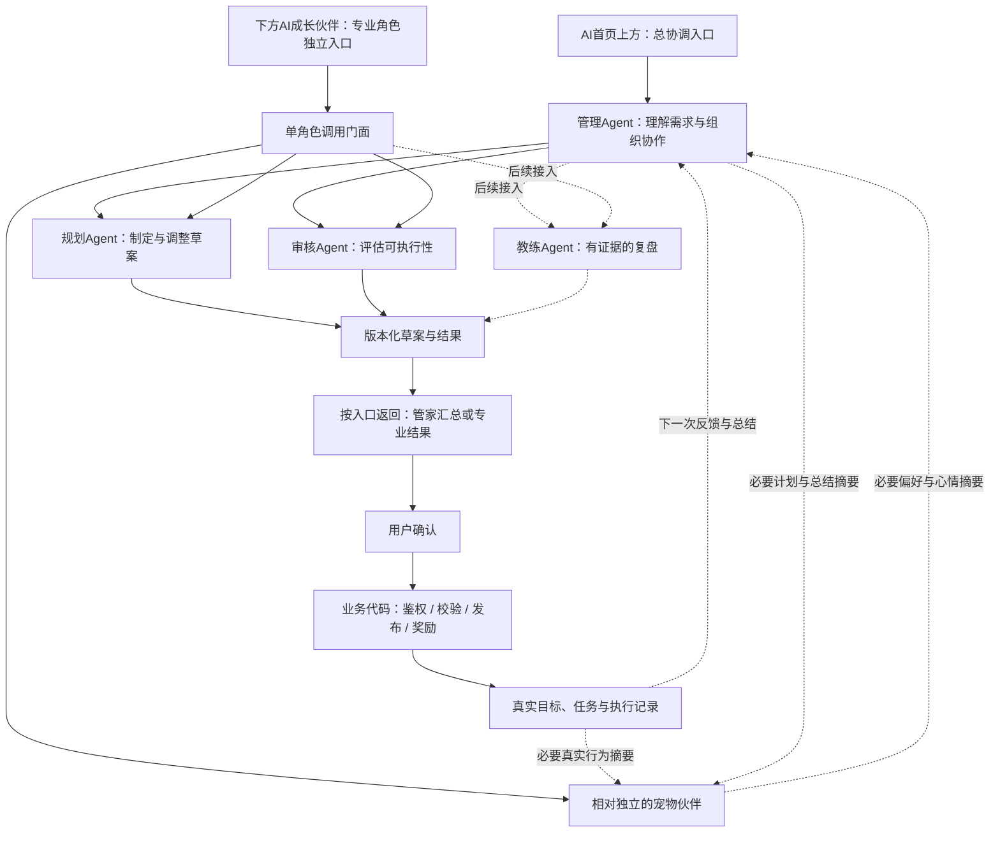

# 多层Agent设计草案

日期：2026-11-06。状态：**总协调入口＋专业Agent独立入口**的设计草案。D032/033已实现本地管家及四伙伴前端（规划/审核/教练/宠物），审核与教练后台AI能力仍待接入，详见AI_PARTNERS_UI.md。下述职责边界、审核策略、LangGraph与云端执行仍是候选，尚未接入框架、部署或验证新增真实模型执行链。

D035复审：用户要求评估现有多Agent问题及具体完成路径，最新优先级/阶段验收见MULTI_AGENT_ROADMAP.md。保留五角色/双入口，先可信目标与草案，再真实审核，再管家与LangGraph、教练、再计划、宠物。当前app的30秒是配置，不是平台硬上限；生产LangGraph/派发/检查点仍未验证，不能因为单次快就忽略恢复，也不因此强制CloudRun。本轮只审查规划，未授权/开始新实现。

## 1. 设计依据与范围

用户已确认：主系统服务“计划→执行→反馈→总结→再计划”的循环；宠物相对独立并与之双向联动；规划师目前体验可保留，只作完善；旧AI教练不作为架构基础，可以暂不处理。D030进一步明确AI首页上方有可见的总协调角色入口，下方AI成长伙伴提供专业Agent独立使用，工具箱继续保留；不再把管理角色只藏在原规划师内部。不删除现有教练入口，新增或调整入口的具体实施另定。

当前可复用：原生WXML/JS页面、aiPlannerChat、生成记录ai_plans、草案编辑、publishAiPlan原子发布/去重、目标/任务/成长日志/宠物业务及Node24副本。当前缺少真实管理委派、模型互审、可靠会话状态、执行统计分析和未来任务调整接口。详情见AI_PARTNERS_REVIEW.md。

首个实施候选只打通管理/规划/审核及可靠确认发布。完整架构保留分析和宠物协作的位置，分阶段实现，不把完整愿景压进第一次改造。

## 2. 首选架构：管理层 + 专业层 + 业务执行层

这里有两个AI职责层级：上层管理、下层专业角色；业务执行层是普通代码，不冒充Agent。上层入口让用户选择完整协作，下层入口让用户直接使用专业能力；二者复用同一批角色与业务工具，不维护两套规划逻辑。

完整协作时专业角色的反馈通过主图状态流转，单用时结果直接返回本专业入口；禁止任意互相调用形成无界循环。首版专业角色可以是有独立输入输出的单次模型节点，不需要各自再带管理器或ReAct循环。后续确有独立多步骤需求时，再把某个节点封装为子图。

### 两种入口的具体体验（D030）

AI首页建议从上到下：总协调角色卡片（暂名“森林管家”）→原AI成长伙伴标题及专业入口→原折叠工具箱。角色名称/卡片文案是助手建议，森林配色、已有图标和工具内部功能继续复用。

- 总协调入口：展示“多Agent协作，制定计划并持续跟进”等明确用途；首次可开始协作，有记录时可继续当前目标。进入独立的协作工作区，呈现当前目标、实际协作步骤、草案和下一项用户操作。它面向普通用户，不是仅管理员可见的技术后台。
- 专业入口：规划师保留现有聊天和编辑发布；审核师检查用户选定草案并说明问题；复盘/分析角色针对一个目标及时间范围作分析；宠物独立聊天。后面三者按实际接入进度提供，不用占位数据伪装已实现。
- 专业区当前前端按D033实现规划师/审核师/教练/宠物四入口，教练承接复盘分析，避免额外重复的分析师；这决定了本轮展示，不等于后端角色与未来扩展全部定稿。审核/复盘服务及云端草案契约仍待建设。
- 单用规划师时不自动进入全员协作；单用分析时不自动生成新任务。结果旁可提供“交给审核师看看”或“交给管家继续”的明确动作，由用户选择扩大范围。
- 总协调体验贯穿实际生活中的多次访问：制定、执行后查看反馈、主动总结和再计划；不能把完整循环实现成一次请求内不停调用模型。

新增总协调工作区是D030后的页面候选；原规划师继续作为专业入口。优先共用需要的消息/草案呈现和后端能力，不复制整份ai.js，也不为新增入口先做全局重构。

### 能力复用与模式边界

后端验证entry_mode为collaborative或specialist；前者进管理主图，后者经角色白名单直达对应能力。单用不等于跳过权限、字段、日期、预算等硬校验。

AI审核策略建议区分：完整协作流程必含审核，单规划流程允许用户自行发起AI审核；发布始终要求用户确认和业务硬校验，未经过AI审核不能显示已审核。此为D030下的助手建议，是否将AI审核也设为所有发布的必要条件仍待确认；不在实现前默默改变原发布规则。

由单用转协作时交接版本化草案、目标引用和用户选定的必要上下文。已有草案可从审核继续，已有目标进入分析/调整分支，不重复生成或创建同一目标。会话历史按模式隔离，必要偏好和业务事实由受控工具共享，不直接混合全部聊天。

## 3. 角色与权限

| 角色 | 输入 | 职责与输出 | 首批状态 |
|---|---|---|---|
| 管理Manager | 当前用户表达、目标事实/待确认信息、必要偏好、已有结果 | 决定继续沟通、生成、分析或调整；准备委派输入；组织有限修订；汇总回复 | 核心 |
| 规划Planner | 已明确的目标/时间约束、阶段信息，必要时带分析结论和审核意见 | 生成可编辑任务草案；按定位明确的意见修订；调整时输出未来任务差异 | 首批先支持新计划 |
| 审核Critic | 草案、用户约束、代码检查结果 | 判断强度、描述、递进、可打卡性，输出通过/问题定位/修订建议 | 核心 |
| 教练Coach（分析职责） | 代码统计的事实、执行记录、用户反馈及数据覆盖范围 | 输出带证据的观察、未知原因、调整建议；需要重排时交回管理层 | 后续；单日事实UI已存在，AI复盘未接入 |
| 宠物Companion | 独立对话历史、宠物性格/阶段、必要真实行为和偏好 | 自然陪伴；提交偏好/短期心情/困难候选摘要；经管理层参与后续建议 | 独立后续阶段 |

所有角色均无权自行改用户role、经验、成长池、完成记录或已发布任务；读取和写入均经账号绑定的业务工具。模型看不到Key、平台凭证、其他账号记录。模型角色不等于应用管理员。

### 管理层的实际判断

- 新目标或有歧义的修改：结合上下文决定是否问一个关键问题、直接规划，或先分析已有执行记录。
- 用户明确点击生成且已有足够目标事实：直接进入受控规划路径，不额外付费再问一次“是否生成”。简单字段确认/已知状态查询可由代码完成。
- “最近总完不成”：有记录时先委派分析；没有足够记录时说明限制并询问用户，不能自动认定任务过重。
- 宠物反馈“最近累”：先保留短期反馈及来源；是否需要分析/调整取决于关联目标、执行证据和用户表达。

管理Agent的价值必须在上下文判断、委派输入和后续组织中体现；显式命令由代码直达不影响其他场景存在真实管理判断。不能把全部固定条件分支改名为智能管理。

代码门禁还要核实用户是否明确请求生成/复盘/调整；管理模型返回generate之类的动作不等于获得用户授权。普通聊天不能因模型猜测就启动整条收费流程或应用新计划。

## 3A. 森林管家：总协调入口的完整设计

实施进展（D032，2026-11-06）：现已完成本地首页入口/独立工作区、现有目标与今日任务读取、原规划师需求交接。审核/复盘/管理调度仅显示待接入状态，不构成下述完整后台能力。具体代码与验证边界见FOREST_STEWARD_FRONTEND.md；本节其余内容继续作为设计候选。

2026-11-06补充。用户要求把森林管家一并规划；以下功能、交互与技术细节为助手设计建议，尚未实施或整体定稿。数据依据见AGENT_DATA_DESIGN.md。

### 定位与首版边界

森林管家负责围绕用户选定的一个目标，组织“明确需求→规划审核→确认发布→查看执行反馈→主动总结→必要时再计划”。它维持目标上下文和协作连续性，专业工作复用下方可独立调用的Agent。

首版同时可存在多个目标记录，但一次工作区只处理用户指定的目标；已有多个目标时让用户选择，不默认抓第一条，也不据此实现多目标冲突协调。原规划师和旧教练入口保留。管家表达温和、简洁、以行动为导向；宠物的独立人格和陪伴聊天仍按D028另阶段建设。

管家维护的是跨多次访问的目标进程。发布后的执行由用户在真实生活中完成，小程序记录其打卡和反馈；等待用户行动期间不保持一个长期模型循环。

### 首次进入与持续使用

1. 没有已有目标或草案：显示简短邀请“想从哪件事开始？说个目标就行。”，允许自由输入。没有明确目标时问关键问题，不自行造出一个通用目标。
2. 有已有目标：提供“继续这个目标”和“开始新目标”，读取归属校验后的目标、近期任务、最新待确认稿和数据覆盖范围；继续时不要求从头重复介绍。
3. 从规划师/审核师转入：携带用户选定的goal_id或draft_id/version和必要摘要。已有草案先检查是否只需审核；已有目标直接进入跟进/分析，不重建一个同名目标。
4. 有未完成运行或待确认发布：先查询原请求/业务回执并恢复对应界面，不点击一次就再启动一遍生成。

普通交流中一次只追问最关键的一两点。目标清楚后可主动生成，缺少周期/预算等时明确展示候选假设，保留编辑确认；不把全部背景字段变成强制问卷。

### 管家在不同请求下怎样决定

| 用户表达或操作 | 先取的数据 | 管家的选择 | 实际结果 |
|---|---|---|---|
| “帮我安排一个阅读计划” | 当前表达、明确目标/预算、必要偏好 | 整理要求；需要时澄清，再委派规划和审核 | 可编辑草案，尚未创建任务 |
| “今天做什么？” | 当前目标及今天任务 | 已有安排时直接查数/导航，不重新生成 | 今日安排或说明暂无任务 |
| “这份计划合适吗？” | 指定草案版本、用户要求、规则检查 | 交审核师检查 | 问题定位和建议，不自动改执行中的计划 |
| “最近总完不成” | 指定期间的任务证据、已有用户反馈、缺口 | 先问关键原因或交真实分析；不能只凭完成率决定原因 | 带依据的观察/建议，缺失信息明确 |
| “每天改成10分钟” | 原预算、现有任务、用户本次修改范围 | 更新候选要求，必要时组织未来任务调整 | 修改前后差异，等待用户确认 |
| “这次太难/今天很累” | 关联目标/任务和本次表达 | 保存必要且可追溯的反馈，判断是否需要进一步讨论 | 不直接重排全部目标，也不写成长期性格 |
| “先停一下”或退出页面 | 当前运行/草案/回执 | 暂停交流或请求停止后续步骤，保留状态 | 重新进入可继续，不等同放弃/删除目标 |
| 重复点击或网络重试 | request_id、运行状态、发布回执 | 返回原结果或恢复查询 | 不重复生成/发布，不伪装新完成 |

分析、未来调整或宠物能力未接入时，管家只能展示已支持的动作和真实基础统计，不能返回占位“深度复盘”。简单查任务不需要先让管理模型决定用什么数据库接口。

### 输入与输出约定

服务端先绑定当前账号并组装最小上下文：本次用户表达、当前目标与已明确约束、必要对话摘要、指定草案及审核版本、所请求期间的统计证据、相关反馈/偏好以及数据缺口。没有请求历史分析时，不默认加载全部记录。

一次管理模型回复可同时输出以下内容，由代码验证后再执行：

- reply：用户可读的自然回应。
- context_updates：候选字段、对应来源、是否为用户明确表达；包括缺口与假设。
- next_action：从reply/ask/plan/review/analyze/propose_adjustment等允许动作中选择。
- target_ref与needed_context：目标/草案引用和需要补取的数据种类，均由服务端校验归属与范围。
- dispatch_summary：对用户有用的简短委派依据，例如“你说晚间任务吃力，先结合本周记录看看”，不保存或展示模型隐含推理链。

管理模型输出不是执行许可；代码还验证用户是否请求该能力、角色是否已接入、预算是否允许、引用版本是否仍有效。不能让模型自行指定集合、任意查询表达式或执行脚本。

数字统计直接来自证据包并由页面/模板展示，模型引用它们作解释。不得把模型重新算出的数字覆盖事实，也不能将查询失败视为0记录。

### 与专业Agent的交接

- 给规划师：目标、明确约束、当前规划覆盖范围、必要偏好和已有草案；需要调整时附原任务引用及分析结论。
- 给审核师：准确的草案版本、用户要求、代码校验结果；返回问题必须指向草案内容或约束。
- 给分析角色：目标、统计期间、代码事实、用户自述和数据缺口，不能让其从奖励总数猜任务完成量。
- 给宠物伙伴（后续）：必要目标进展/真实行为摘要；反向接收带来源和有效范围的偏好/心情候选。具体共享范围另定。

专业输出回来后，管家组织下一步。明确的规划→审核→有限修订顺序由图执行，不为每条中间结果再调用一次管理模型“确认收到”；出现需要用户决定的约束冲突时再回到交流。模型判断和确定性控制共同组成有界管理。

### 页面内容与状态呈现

入口位于AI首页“AI成长伙伴”上方：森林管家角色卡片、用途“组织多个AI伙伴，陪你把计划做下去”，主操作按真实状态显示开始协作/继续当前目标。名称文案是候选，视觉沿用森林绿#2D4A3E、木棕#8B6914、米黄#F5E6C8，字体沿用苹方/微软雅黑，现有图标保留；本稿未新增素材。

进入独立工作区后按以下顺序组织，避免把技术架构图当聊天主界面：

1. 当前目标条：目标名、当前阶段、切换目标入口；无目标时留给自然沟通，不造进度。
2. 主要聊天区：管家回应、用户补充及必要证据摘要。
3. 按需出现的结果：草案、复盘或调整差异。草案编辑复用原有能力，直接标明是待确认稿还是已发布任务。
4. 可展开的本次协作：实际调用的角色、简短输入来源、结果、失败或修订；默认只露一行状态，不常驻全员动画。
5. 输入和当前主操作：沟通时发送/主动生成；有草案时编辑确认；执行阶段查看任务/反馈；有调整建议时查看差异。能力尚未接入时不显示可执行假按钮。

目标阶段（沟通/待确认/执行跟进/总结或调整）与一次运行状态（排队/处理中/待用户/完成/失败）分开保存。运行生成结束不等于用户目标完成，目标继续执行也不代表后台一直调用模型。

### 记忆、失败与控制边界

- 保存当前目标明确要求、必要对话摘要、草案/发布引用、已发生的协作和用户反馈。用户表示更改要求时形成新版本，不用旧假设覆盖新表达。
- 短期心情只在合适范围内使用，长期偏好另记来源；宠物原始聊天不默认整段共享。后续允许用户查看/纠正必要记忆的机制另阶段设计。
- 查询失败明确说明哪部分暂时无法读取并可重试；模型失败保留输入，来源清楚的模板若提供也不能冒称模型审核通过。
- 停止生成先记录取消请求，阻止后续节点/发布。已发出的模型请求不保证立即中止，可能已产生用量；晚到结果不能自动发布。停止当前操作不删除已发布任务。
- 暂停确认依赖持久检查点，业务写入继续依赖原幂等事务和回执。并发编辑/重试按版本、请求标识和运行租约处理，失败恢复方案见第8节。
- 普通管理交流目标1次模型调用，查询等明确操作可0次；生成预算按第6节最多5次尝试/修订1轮的候选上限。不能隐式拆成多个运行绕过上限。费用沿用当前账号模型配置，不在本阶段更换供给方式。

### 推荐实施分段与完成标准

以下为待评审规划，不是本轮实施授权。各阶段包含数据和用户可见效果，不能只先画入口就声称管家可用。

| 阶段 | 落地内容 | 完成标准 |
|---|---|---|
| 数据与运行准备 | 目标事实/草案快照、必要严格读取；验证服务端受理/后台执行/检查点/查询 | 归属和缺失状态清楚，关闭页面不依赖客户端推动，重试/恢复不重复处理 |
| 管家首版协作 | 新入口和工作区，管理需求沟通，复用规划/审核/原编辑发布；支持已有草案交接 | 用户看到真实委派、有限修订和确认结果；原规划师仍可单用；重新进入能继续 |
| 真实跟进与复盘调整 | 按目标/日期统计，轻量用户反馈，分析Agent，未来任务差异提交 | 结论有来源，缺信息不推断原因，确认调整不碰已完成记录和历史奖励 |
| 宠物双向联动 | 真实行为摘要与有限偏好/心情反馈接入 | 同一条反馈能追溯到后续建议，短期心情不永久改要求，无跨账号混用 |

首版协作的关键验收：当用户给出清楚目标并要求生成时，系统不以填满所有字段阻断；当预算冲突时，指出位置且最多修订一次；当用户编辑已审草案时，对实际版本重新检查；当已有目标被交接时，不重复创建；当发布响应丢失时，以原回执恢复；当分析能力尚未接入时，明确能力边界而不提供模拟结果。

## 4. 保留规划师体验的接入方式

### 保留

原菜单、聊天样式、输入/发送、顶部生成计划、重新开始、草案弹窗、编辑任务和发布后跳转。初次生成仍沿用当前少量具体任务的形态（提示词3—6项、发布1—20项），不擅自改为整月铺满；滚动窗口与重复任务规则另议。

### 必要完善

1. 后端持有可信的会话与目标上下文。aiPlannerChat保留reply兼容字段，可附结构化状态；前端不再从模型建议文字里猜出“用户已确认”的目标和时间。
2. 单规划入口由规划角色进行本专业的对话与候选字段提取；总协调入口由管理角色给出自然回答、候选字段和下一动作。二者共用字段约定、模型调用适配和状态服务，不因模式切换多叠一次管理模型调用。明确区分用户原话、模型假设、业务事实；“建议30天”不能直接等同于用户决定30天。
3. 生成条件只要求目标清楚，其他缺失项可作明确标示的假设供编辑，不引入强制完整问卷。信息不足且无法合理假设时才追问。
4. 专业规划师保留原聊天，只有实际调用的步骤才显示进度；总协调工作区展示真实委派、审核与修订摘要。它有独立入口，替代前稿“不新增总协调入口”的设想；管理员技术运行视图仍另议。
5. 补齐已确认的生成分支问题：JSON解析失败不再伪装正常模型成功；模板来源要明确且能走完受控发布。修正超时分支弹窗/恢复、草案与generatedTasks工作副本的状态一致性，以及重复生命周期定义造成的清理覆盖。

这些是接入所需的局部完善，不借此重写整份ai.js或改动其他工具内部功能。

## 5. LangGraph.js的落点与选型取舍

首选一个受限的StateGraph主图，专业角色为独立节点，确定性校验和用户确认也是节点；业务层独立。LangGraph可混合代码、模型和Agent节点，适合此处的显式约束与可恢复流程。[官方自定义工作流](https://docs.langchain.com/oss/javascript/langchain/multi-agent/custom-workflow)

| 路线 | 本项目判断 |
|---|---|
| StateGraph + 明确管理节点 + 有界专业节点 | 首选；便于复用现有HTTPS模型适配，控制修订与状态 |
| 通用Supervisor工具调用循环 | 可作以后参考；当前模型适配只有文本接口，额外工具消息/自动循环不是首批必要条件 |
| 每个伙伴带独立团队/多层子图 | 当前成本过高；把节点接口留好，确有多步骤业务时再拆 |
| 自建状态机 | 无框架部署条件时的备选，但恢复和运行记录需自维护；现有实验已证明LangGraph核心可运行 |

不强制安装Supervisor、Deep Agents、整套AG-UI或替换小程序聊天组件。LangGraph不要求所有角色都拥有长期记忆；多数一次性专业委派可使用调用隔离的状态，主会话维持连续上下文。[官方子图说明](https://docs.langchain.com/oss/javascript/langgraph/use-subgraphs)

已有隔离基线：Node24下LangGraph1.6.1/core1.3.4及CloudBaseSaver适配实验15项通过。它证明流程/保存器配合本地替身可行，不证明真实模型、云端检查点、并发和后台执行已可用。正式接入先检查锁文件/peer依赖，不为追新顺带升级现有业务SDK；目前模型仍复用账号已有配置。

## 6. 运行流程与预算

### 普通对话

账号鉴权 → 按入口读取独立会话状态 → 总协调模式调用管理节点/单用模式调用所选专业角色 → 自然回复及结构化候选更新 → 校验更新 → 保存状态 → 返回该入口。

普通模型对话目标为1次模型调用；确定性操作可为0次。用户未要求规划/复盘时，不强行调用全部角色。

### 制定计划

以下描述总协调模式；独立规划入口只调用规划能力及共用代码校验，用户可主动追加审核或转入协作，最终发布策略见第2节待定项。

读取目标快照 → 按需作管理判断 → Planner → 代码硬校验 → Critic → 必要时Planner修订一次 → 重新校验/复核 → 保存版本化草案 → 等待用户确认。

- 代码校验日期/周期/任务上限/单项时长和同日总预算、必需字段；不能靠审核提示词代替算术。
- Critic只判断合理性，返回带任务标识的问题；不自行改草案。
- 一轮修订后仍失败则保留问题返回用户，不循环直到“通过”。模型格式修复、模型请求重试也计入本次预算。
- 正常生成约2次专业调用；管理判断确有需要时再加1次，修订与复核再加2次。首批生成运行建议硬上限5次模型尝试，实际Token和耗时另设边界；这是设计上限，不是成本或延迟实测。
- 不自动多次重试收费模型请求。响应丢失时无法承诺模型调用恰好一次，必须记录未知结果并受预算约束。

### 编辑与确认

草案保存draft_id/version/fingerprint、要求版本、入口模式和审核策略；审核结论绑定准确内容、要求及规则版本，任务定位使用稳定标识。用户仍按原弹窗编辑，确认时检查实际提交的那一版。以下重审要求适用于完整协作或已要求AI审核的草案：

- 未改变的已审草案：业务校验后复用publishAiPlan原子发布。
- 内容/日期/时长改变：审核状态失效，确认请求触发必要复核；若原样通过可继续发布用户刚确认的内容。若系统又修改草案，返回弹窗展示修改，重新确认，不能静默发布另一个版本。
- 等待确认可用interrupt保存暂停状态；它不是保持一个云函数一直等待。恢复时节点会从头运行，写入必须继续使用独立幂等发布接口，不能将非幂等副作用放到interrupt之前。[官方暂停/恢复](https://docs.langchain.com/oss/javascript/langgraph/interrupts)
- 目标/任务/发布回执仍由现有业务事务负责；检查点、agent_runs日志都不替代业务提交回执。断网重试后以回执为准，避免重复创建。

### 执行、总结与再计划（后续）

用户实际执行任务/打卡 → 业务保存真实结果 → 代码生成简洁反馈与统计 → 用户主动请求复盘时调用Analyst → 管理判断是否需要调整 → Planner生成未来任务差异 → 校验/审核 → 用户确认 → 专用调整接口应用。

统计必须区分任务完成、每日签到、预计时长、用户报告的实际情况；当前estimated_minutes不能当作实测耗时，未打卡不能直接认定没有执行。原因不明时明示数据不足。

当前没有完整任务调整API；publishAiPlan创建新目标，不能冒充更新原计划。后续另实现带目标/任务版本校验的adjustment_id差异提交，只变更允许的未来未完成任务；已完成记录、历史奖励和其他目标保持原有数据。它属于后续独立范围。

## 7. 状态、接口与账号隔离

当前数据从哪里来、独立审核草案如何获得、哪些审核规则已存在、教练统计/反馈的可用字段及缺口，详见[AGENT_DATA_DESIGN.md](AGENT_DATA_DESIGN.md)（2026-11-06源码核查与候选设计）。不能把下面的设计字段当成已落库事实，也不以dashboard今日摘要或情绪页示例替代历史证据。

| 信息 | 设计字段或边界 |
|---|---|
| 会话 | 服务端绑定owner；conversation_id、goal_id、graph_version。thread_id由服务端生成/解析并验证归属，不能信任客户端任意传入 |
| 调用模式 | collaborative/specialist及允许的target_agent；角色实现共用，模式决定是否进入管理图和是否请求其他模型角色 |
| 目标事实 | 字段值、来源消息/业务记录、明确表达或候选假设、更新时间；更改保留版本 |
| 一次运行 | run_id、request_id、输入快照版本、当前节点、状态、调用/修订计数、最后错误 |
| 草案 | draft_id、version、fingerprint、内容、审核版本、用户确认版本、publication_id |
| 偏好反馈（后续） | 来源、长期/短期类别、候选/用户明确表达、有效期、可纠正状态；不把推断写成事实 |
| 运行摘要 | 实际角色、必要输入/输出摘要、工具调用、耗时、状态、模板来源、Token用量（未返回则未知） |

模型不接收全数据库或所有原始聊天，专业节点只取完成职责所需的上下文。每个用户的数据按owner隔离；角色实现共用，不为每个用户复制整套服务。

接口建议尽量保留既有边界：aiPlannerChat承担专业规划师聊天兼容门面，总协调工作区经独立逻辑门面进入管理图；二者共用模型适配、目标上下文约定和专业节点。aiStartGenerate受理生成并返回plan_id/run_id，aiPollPlan查询进度/草案；publishAiPlan继续负责受控发布，按确定的模式策略加入审核版本门禁。aiDoGenerate内部生成逻辑抽成Planner可复用模块，不让新页面继续串行等待旧aiDoGenerate完成全部步骤。新门面与确认恢复接口的具体命名待实施时定。

未发布的Agent运行数据可新增受管理端保护的运行/检查点存储；ai_plans继续保存与原发布接口兼容的来源和草案引用，禁止把业务发布回执与图检查点混为同一状态。具体集合名以实际CloudBaseSaver行为及真实数据库试验为准，本轮不建集合。

同一会话的变更按版本和运行租约串行化；重复request_id复用原运行，重复回调也不能生成第二份稿或覆盖新版本。检查点自身不自动解决跨进程并发竞争。

## 8. 后台执行：先解决30秒，保留当前前端通道

已知事实：app-node24业务路径仍按30秒配置；当前“创建生成记录后等待aiDoGenerate”不是可靠异步队列。D035补充：官方普通函数配置支持更长超时，30秒不是已验证的平台硬上限；独立事件函数的资源配置与实际调用渠道仍须实测，不因单次几秒就忽略恢复。项目project.config.json基础库为3.14.3。官方集成指南将wx.cloud.callHTTPFunction最低基础库列为3.15.2，因此不把小程序直调HTTP Agent服务作为无需改动即可采用的前提。[CloudBase调用前提](https://docs.cloudbase.net/integration/usage)

首选部署形态（待专项验证）：同环境独立Node24 Agent执行模块，原wx.cloud.callFunction门面负责可信身份、受理与查询；长运行经服务端受支持的异步调用派发给worker。腾讯SCF Invoke API提供Event异步调用，但该能力到本项目CloudBase函数的映射、执行角色授权及Node24部署必须实测，不以普通SDK的callFunction名称推定支持。[腾讯云Invoke API](https://cloud.tencent.com/document/api/583/17243)

可靠受理要求：先持久化带owner的运行请求，派发确认后返回已受理；worker只按已保存的run_id读取可信输入，不接收任意客户端openid。派发失败有明确状态；租约/到期恢复处理worker崩溃和重复投递，避免永远pending。前端查询只读取状态，不负责推动下一个节点，关闭页面后不依赖手机继续运行。

恢复调度必须有服务端执行者（优先验证平台重试能力，必要时用受限定时触发扫描过期运行），不能只设计一个过期字段。worker入口限制为可信服务端调用，并验证投递和run_id；读取运行记录、工具调用和确认恢复都沿用原受理账号归属，不能因异步worker没有微信调用上下文而退回信任客户端身份。

普通聊天首批仍可使用现有短请求；生成/复核等长操作由worker运行。worker超时、单模型超时、总调用/Token预算与检查点写入需联调配置，不能只延长前端等待或在函数return后放一个未await的Promise就宣称可靠后台执行。

如果同环境异步调用不能在明确权限和合理代码代价下落地，再重新评估HTTP云函数及可信服务端接入，必要时单独讨论基础库升级。当前官方配置页、Agent部署页和FAQ对超时上限存在不同口径，以目标资源实际可配置/运行结果为准，不在本稿承诺某个最大时长。主线业务函数及已发布旧入口不因Agent试验被覆盖或停用。

## 9. 宠物与主系统的连接位置

宠物保持独立对话和人格，不必经过管理Agent才回复每一句话；需要规划/调整时，经受控请求进入主图。它当前不被指定为总管理Agent。

主系统向宠物提供已发生的必要业务摘要，例如目标发布/任务完成/喂养记录；宠物向主图提供偏好、短期心情和困难候选，附来源和有效性。主图在下一次对话/规划/总结中使用相关反馈，不让一条“今天很累”永久降低全部目标强度。

首版只预留输入输出接口与必要摘要位置，不引入向量库或事件总线。具体记忆/触发设计另阶段完成。真实业务状态来自已提交数据，模型不能虚构完成/喂养事件；宠物也不能通过聊天绕过奖励或计划确认。

## 10. 有界实施阶段与验收建议

以下是候选阶段，不是已授权执行清单。

| 阶段 | 用户可感知结果 | 关键验收 |
|---|---|---|
| 接入前试验 | 不改正常页面 | 用真实身份证明受理/派发/执行/查询；页面离开后完成或明确失败；真实检查点可恢复；重复任务/运行隔离；核清依赖和权限 |
| 总协调入口+管理/规划/审核 | 上方角色进入真实协作；原规划师可独立使用，专业审核入口按已接入能力提供 | 单用不强制全员；协作真实审核/修订；转交已有草案不重复创建；编辑后按策略重验；重复确认不重建任务；模型失败明确 |
| 执行事实+主动分析+未来调整 | 以真实数据解释执行，展示调整前后差异 | 今日/累计/签到口径分开；数据不足不编造原因；修改仅作用于确认范围内的未来任务，保持目标关联和历史奖励 |
| 独立宠物联动 | 聊天结合真实经历，偏好能影响后续建议 | 偏好/心情来源可追溯和纠正；跨账号隔离；重复行为不重复奖励；不把对话推断自动当成长期事实 |

首批不重做旧教练、不做管理员技术工作台、拖拽编排或多目标调度；新增的是普通用户可进入的总协调工作区。运行记录支撑真实协作展示，后续每阶段按当时证据调整范围。

## 11. 最小改动落点

- miniprogram/pages/ai：原首页加总协调入口、专业入口按接入进度扩展；原规划师集中改状态接收、生成受理/查询、草案版本和错误展示，保持聊天主体。
- 总协调工作区（新增页面候选）：承载管理对话、目标连续状态和协作记录，复用必要消息/草案组件；具体路由尚未确定，本轮不创建。
- miniprogram/utils/cloudApi.js：保留现有门面，必要扩展运行状态和确认字段；不重做所有工具调用。
- 独立Agent模块：存放graph、角色函数、输入输出校验、模型适配和运行存储；避免把LangGraph依赖塞入整个旧app单文件。
- cloudfunctions/app：复用身份和业务模块，增加必要受理/查询/审核版本门禁；原发布事务继续复用，原Node16已发布入口不参与试验。
- tests：实施时验证真实角色数据依赖、约束和失败/重复/编辑/恢复场景；不把固定替身互相调用写成已验证模型协作。

## 12. 本稿仍需一起决定的产品规则

本次先评审分层和职责。随后细化审核硬约束、缺信息时默认值的呈现、首次生成的任务覆盖方式，以及宠物反馈允许影响哪些内容。角色数量、具体部署和后续分析入口可随实证调整；不因本稿写了流程就固定所有未来开发。

本轮成果为设计与资料复核，没有新增实现/部署证据。官方能力说明与本项目15项隔离实验、先前微信限量联调应分开理解。
