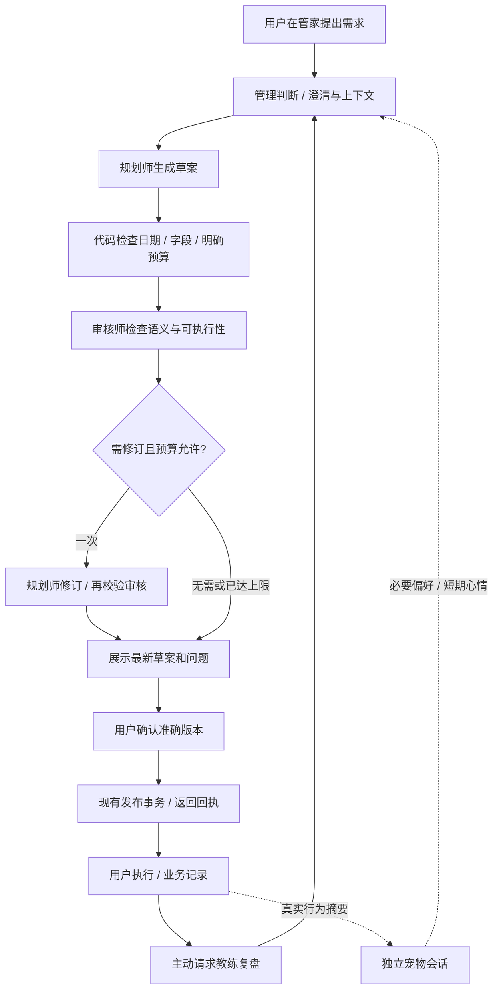

# 多Agent设计复审与落地路线

日期：2026-11-06，D035。依据D034真实模型联调、当前源码及本轮官方资料复核。

最终执行补充（D039）：阶段4本轮正常主链已收尾，用户原生脚本和云只读核对反馈revision 4→5、旧复盘不再作为当前结果且历史保留。1533项本地断言；普通账号/真机/云并发异常未验收。以下历史待办以此为准，阶段5A差异草案/审核和5B确认应用仍是第10节待确认建议，未实施。

D039管家共享定位：用户定位脚本和截图显示“建立游泳习惯”/反馈第1版、页面与云端都无报告；只读云核对成功的第3版复盘实际属于“300天晨跑计划”（3观察/2建议）。两页保留独立目标，管家打开教练又切换其目标，sameGoalAsCoach只比较当前选择，不证明与生成时一致。已本地增加成功复盘下“到森林管家查看本次复盘”，账号隔离交接准确目标/日期，管家校验可访问目标后自动打开复盘页，刷新/返回教练保持日期；无权或已删除目标不回退到其他复盘。1533项本地断言、两页WXML编译及91项渲染通过；仅前端改动，无云部署/模型调用/业务写入，待用户编译验证精准跳转，再验改反馈失效。见COACH_REVIEW.md。

D039真实复盘补充：修复后用户回复“可以，一切顺利”，确认同步状态及AI复盘正常；助手只读核对反馈已第3版，当前报告status=done/isCurrent=true，snapshot使用第3版反馈，3条观察/2条建议。该报告为第3版反馈的新指纹、attempt=1，不能写成旧第2版失败报告已成功重试；不再要求额外模型调用。管家同目标共享与改反馈后旧结论失效仍待用户验收，未开始未来任务调整。见audit/coach-cloud-success-20261106.json。

D039故障修复补充：用户首次复盘出现内容校验错误，并感觉反馈未保存。云端只读确认反馈已存第2版，失败报告读取的也是第2版、attempt=1；并非反馈丢失，恢复/共享仍未验收。已核实旧本机状态文字误导，以及条目格式/引用格式/无效ID共用同一错误；未保存模型原始输出，不能认定本次具体哪个字段不合规。已明确引用白名单/有效JSON示例和长度要求，教练仅对官方DeepSeek端点开启JSON输出/较低温度；保留无效引用拒绝，拆分校验错误及保留反馈提示。本地保存状态/成功提示已改清楚。全套1520断言（教练95后台/50客户端）、10份变更JS语法、WXML编译及59项渲染通过；沿用用户已批准的同一教练三文件范围更新并下载核对，其余3785文件/Node24/30秒/256MB/配置不变。没有新增助手模型调用/业务写入或发布，待用户编译、一次手动复盘重试/共享/失效；不推进阶段5。见COACH_REVIEW.md及audit/coach-stage4-repair-validation-20261106.json。

执行补充（D039）：阶段4教练本地完成：7天真实事实/明确云反馈/证据绑定主动复盘，管家只读共享；1499项本地断言及两页模板/布局检查通过，真实云只读分页/统计预检通过。用户明确批准后已更新app-node24三文件并下载核对，其余3785文件/配置保留；未真实native保存或模型联调；没有自动修改任务。用户微信只读列表/7天读取已通过（27目标、complete=true），反馈保存/模型/共享/失效仍待联调。下一步限量验收后再讨论阶段5未来任务差异与用户确认应用，其余架构扩展仍另定。见COACH_REVIEW.md。

执行补充（D038）：D037正常主链通过后，用户要求推进首条管家协作，阶段3A本地已实现有界LangGraph/共用规划审核/真实步骤/暂停恢复，1375项本地断言及模板/布局检查通过，用户已单独批准五文件部署并下载核对，其余3781文件/配置不变；部署无模型调用/业务写入，已有稿/新需求云端主链、用户重进继续、等待确认时取消及草案审核保留已通过，本轮阶段3A正常验收完成；运行中取消竞态仍主要本地验证。助手下一轮建议先对齐阶段4教练事实/反馈/主动复盘，尚未授权；阶段3B自动修订/管理模型/后台扩展另定。首轮采用前台分段/持久恢复，关闭页面暂停后续；替代下文“首轮先新建后台worker”的前置条件，后台持续执行仍另验。管理层先代码协调，等待人工修改/确认；自动一轮修订及管理模型等仍为后续范围。见FOREST_STEWARD_WORKFLOW.md，未把整个阶段3或其余阶段标为完成。

执行补充（D037）：阶段1真实正常草案联调通过后，用户要求继续，阶段2独立审核师本地实现完成：版本化规则/主动语义建议、幂等模型调用和修改后失效。1287项本地断言及模板/布局检查通过，用户明确批准后已部署五文件并下载核对，其余3778文件/配置保留，部署无模型/业务写入。用户已返回改稿后revision=3/无新审核回执，并确认建议生成/重编译恢复/改稿失效均正常，独立审核正常主链验收通过；下一步对齐阶段3管家+有界LangGraph的技术验证、最小协作与恢复范围，后续阶段仍非整套已授权。见[PLANNER_REVIEW.md](PLANNER_REVIEW.md)。

执行补充（D036）：用户随后要求推进开发，阶段1已完成本地实现/1168项检查，用户明确批准后已部署app-node24三文件并核对，用户生成/编辑保存/重编译恢复的正常草案联调已通过；真实并发/断网仅本地验证，见[PLANNER_DRAFT_FOUNDATION.md](PLANNER_DRAFT_FOUNDATION.md)。下文“本轮只规划”描述D035当时边界，其他阶段仍是候选。

**本轮授权是审查与规划。下文是助手推荐方案，不是整套实施/部署授权。** 保留原规划师聊天、森林风格、双入口、单目标优先、用户确认后落地、宠物相对独立等既有要求。阶段交界再根据证据调整，不机械执行一张固定技术清单。

## 1. 结论与现状

保留“森林管家＋规划师/审核师/教练/宠物伙伴”。近期主要工作是让已有角色共享可信的上下文、草案和运行结果，不再增加角色数或继续堆展示页面。

| 层面 | 已有证据 | 尚未完成 |
|---|---|---|
| 规划师 | DeepSeek当前配置连接成功；聊天3106ms；正常生成总4907ms、6项游泳任务；用户确认审核师可见稿 | 可信会话状态、可靠结构化字段、生成异常与原稿一致性 |
| 审核师 | 原生UI、当前编辑稿/待确认原稿读取、本页快照编号 | 云端草案版本、真实代码/模型审核、编辑后失效与复核 |
| 教练 | 选定目标/单日真实任务、按账号/目标/日期本机反馈UI | 期间事实包、云端反馈、真实AI复盘、未来调整 |
| 森林管家 | 目标/今日任务读取、专业角色跳转、分工状态UI | 管理模型判断、实际委派、图状态、持续会话与运行恢复 |
| 宠物 | 现有规则聊天/宠物互动路径 | 有人格和历史的模型聊天、必要记忆、主循环双向联动 |
| LangGraph | 固定版本隔离实验15项、Node24本地兼容证据 | 生产部署、真实云检查点/身份/并发/模型协作验收 |

1052项现有回归主要验证业务可靠性与页面/配置路径，不能当多Agent效果已经验证。D034耗时是单次成功样本，不是P95或持续性能承诺。当前deepseek-chat已可连接，保留用户可用配置，不为了框架更换供应商。

## 2. 当前最需要解决的问题

| 优先级 | 代码/实测依据 | 对多Agent的影响 | 推荐处理 |
|---|---|---|---|
| P0 | what被提取成“先了解一下你”，而结果是“10天学会游泳”；_extractWhat泛化短句，_extractFromAIReply会填空 | 审核和再计划会以错误目标/模型建议为依据 | 用户原话、业务事实、模型候选分开；明确改目标时替换旧值；服务端保存来源与版本 |
| P0 | 当前审核编号只是页面内递增，任务展示主要用数组索引 | 无法证明审核的是用户最终确认的那一稿 | 云端不可变草案快照、稳定任务标识、要求版本、审核规则版本；旧结果失效 |
| P0 | JSON解析失败可返回未标明来源的模板；前端30秒超时也会生成本地稿；生命周期有重复定义 | 假成功、晚到响应、状态分叉可能进入后续审核/发布 | 明确model/template/error来源，过期结果不覆盖新稿；修正恢复与清理，复用既有幂等发布 |
| P1 | 管家与专业入口尚无共用的真实角色服务/运行状态 | 易形成几套提示词和重复生成逻辑，UI不能证明协作 | 专业角色独立函数/节点，双入口共用；管家只组织必要角色 |
| P1 | 教练只有单日记录和本机反馈；目标页progress主要是今日完成率 | “执行差/目标完成/没有数据”等口径容易混淆 | 日期范围事实包与覆盖说明；今日、期间、目标状态分开；未打卡不等于现实没执行 |
| P1 | 当前app-node24配置30秒，aiDoGenerate仍由前端等待；无可靠调度/生产checkpointer | 多次模型串联会超时，退出/重试可能失联或重复收费 | 同环境独立执行模块，先验证平台能力，再选可靠派发/恢复；查询不推动下一步 |
| P1 | 模型适配主要返回文本，provider虽已固定但没有完整运行预算/usage/配置版本 | 不易控制修订、重试和中途配置变化，难解释费用 | 运行级调用上限、持久计数、可用usage/耗时、供应商/模型/配置版本快照 |
| P2 | 宠物规则回复，没有可靠偏好/心情记忆或主循环交接 | 单纯多加一个聊天接口不能形成自然陪伴与协同 | 单独会话和人格，按需读真实事件；必要摘要带来源/有效期，分阶段完善 |

计划周期、安排覆盖和完成定义也应分开：本次10天目标只有6项任务，不足以证明每天都有任务或现实中已掌握游泳。当前发布上限20项，不在本阶段强制把所有长目标铺满。首版明确显示已安排的具体日期，未安排日期不当失败；目标达成不从“今天100%”自动推断。

## 3. 最终职责与模块边界

- **森林管家**：维护当前目标上下文，判断应该澄清、规划、审核、复盘还是准备调整，组织结果与下一动作。不是应用管理员，无权改role/XP/完成记录。
- **规划师**：本专业对话、提出草案、按反馈改稿。保留现有聊天/主动生成/编辑体验，不强制完整问卷。
- **审核师**：对准确版本做独立检查，输出定位到任务/约束的问题和建议。只给结论，不直接改稿/发布。
- **AI教练**：依据事实包和用户反馈复盘，原因未知时承认缺口，提出调整建议。规划调整交给规划师。
- **宠物伙伴**：独立自然陪伴；需要专业帮助时可转交主系统，反馈必要偏好和短期困难。不是每次规划的必经节点。
- **业务代码**：取数、算数、鉴权、规则、状态/预算门禁、确认、事务写入/幂等。代码节点不冒充Agent。

下层首版用职责明确的普通函数/模型节点，不要求每个节点再带一个管理层；同一批实现供管家和独立入口使用。按用户隔离会话/草案/运行，不为每个账号部署一套服务。

建议逻辑模块：modelAdapter（沿用当前Key解析/HTTPS）、goalContext、draftService、roles（planner/critic/coach/companion）、workflow、runStore、businessTools。只抽接入需要的AI逻辑，不重写整个app/index.js或2800行ai.js，不影响其他工具箱功能。

## 4. 所有角色共用的最小数据约定

| 对象 | 最少需要的信息 | 关键规则 |
|---|---|---|
| 目标上下文 | 字段值、来源消息/业务记录、原句片段、明确表达或模型候选、修订版本 | “我想先了解你”不作行动目标；助手建议20分钟不能当用户预算；明确变更可更新旧值 |
| 草案版本 | draft_id、revision、稳定task_id、内容指纹、要求版本、来源model/template、覆盖日期 | 快照不可变，编辑产生新版本；不是先创建真实目标/任务再审核 |
| 审核报告 | 草案id/版本/指纹、要求版本、规则版本、范围/未检查项、问题定位、结论和建议 | 任一相关版本变化需复核；无预算就说明该项无法验证，不能写“符合预算” |
| 一次运行 | run_id/request_id、owner、入口/目标引用、输入版本、当前步骤、状态、调用/修订数、取消标记 | request_id去重、单工作区并发受控，旧运行不能覆盖新稿；ID本身不等于身份权限 |
| 模型配置引用 | provider/model/baseURL及配置引用/版本 | 本次运行固定配置；Key只在服务器调用时读取，不进图状态、检查点、UI或日志；配置变化明确处理 |
| 执行证据 | 目标/期间、任务事实与分母、缺失项、用户反馈及来源 | 代码算数，模型解释；0任务不是100%，今天未结束单列，反馈只是用户自述 |

这些是逻辑对象，不要求立即一对象一集合，也不新建每Agent一套数据库。ai_plans的生成来源/发布回执继续兼容；草案、运行、检查点的物理存储按事务边界和实际CloudBaseSaver行为在实施时确定。

普通规划对话优先一次模型调用同时给自然回复和结构化候选，服务端校验后更新，避免每条消息额外再叫一个“提取Agent”。明确的用户表达可直接采纳；有歧义才简短追问，不逐字段强制确认。

服务端逐步持有可信消息序列，客户端提交本轮用户表达与会话引用，而不是自行拼任意system/assistant历史作为事实。前端保留本地编辑工作副本，通过适配层引用云端准确草案版本，收敛generatedTasks/editableTasks等重复状态，不借此全局重构。

## 5. 首选技术与执行形态

**首选：TypeScript独立Agent模块 + LangGraph.js有界StateGraph，保留原生小程序、wx.cloud.callFunction门面、云数据库和现有模型商HTTPS适配。** 目前模型文本接口可封装成节点，LangGraph不要求先实现所有工具调用协议或每角色子图。[官方自定义工作流](https://docs.langchain.com/oss/javascript/langchain/multi-agent/custom-workflow)

采用依据：实际需要分支、有限修订、等待用户、恢复和追踪；不是为了把一条简单函数改名为Agent。只有单次审核时，可以先调用同一Critic函数；进入多步管家协作才由图统一组织，避免把所有简单请求都强塞进长图。

| 候选 | 本轮复审结果 |
|---|---|
| LangGraph核心 + 自有门面/现有UI | 首选，已有隔离基线，控制共享状态/有限循环/恢复；需验证真实部署产物与checkpointer |
| 纯自建状态机 | 特别短的单步请求继续用普通代码；完整协作恢复全自维护的长期成本偏高，作为框架受限时备选 |
| CloudBase Agent Server/AG-UI整套 | 将来需要统一流式协议时再评估；当前引入会扩大服务、依赖和前端接入面 |
| 通用Supervisor/每角色一个团队/换整套Agent框架 | 首版收益不足，不增加没有业务依据的循环/存储/模型调用 |

**反思旧部署假设：30秒是当前app配置，不是已证实的平台硬上限。** 当前官方普通函数配置支持更长时间；不能仅因此强制CloudRun，也不能把单次3—5秒样本当多步骤永不超时。[CloudBase配置文档](https://docs.cloudbase.net/cli-v1/functions/configs)

推荐先验证同环境独立Node24事件执行函数，不改现有业务函数时限；保留可信native受理/查询。可靠后台生成首选服务端异步派发给执行器，先持久请求再投递，重复投递以租约/运行版本控制。SCF有Event异步API，但到该CloudBase资源的映射/权限未实测，阶段3设明确验证关口。[腾讯Invoke API](https://intl.cloud.tencent.com/zh/document/product/583/17243)

若异步映射不适配，重新比较独立云函数的直接调用限制及HTTP执行服务；只有隔离测试确认较轻方案达不到受理/后台恢复/鉴权要求，才选CloudRun。不会为了框架先让用户升级基础库、装AG-UI、向量库、Redis或消息中间件；具体部署仍要独立列范围。

检查点负责图状态，业务回执负责正式写入；恢复可能重入节点，写入继续走现有publishAiPlan事务/幂等，不能因为用了interrupt就认为天然只执行一次。[官方持久化](https://docs.langchain.com/oss/javascript/langgraph/persistence)、[恢复与幂等](https://docs.langchain.com/oss/javascript/langgraph/fault-tolerance)

## 6. 实际协作和确认规则（推荐）

- 完整协作要完成审核步骤；单独规划师保持可主动追加审核。这个策略仍待用户最终确认，不默默改变旧发布门禁。
- 代码硬错误/违反明确硬约束阻止发布；模型关于难度、措辞、递进等建议可以由用户明确选择采纳与否。审核服务失败显示未完成，不能伪装通过；可保留草案或明确选择退出协作改用原单规划流程。
- Critic输出“可用/需修改/信息不足”及具体问题，不先造百分制评分；单独上下文读要求/草案/证据，不盲从规划师的自我解释。同一供应商可承担不同职责，不承诺“同模型自审一定正确”。
- 用户编辑后生成新稿并使旧结论失效；后续若系统又改稿，必须展示再确认，不能发布用户未见过的版本。
- 日常统计0次模型；普通聊天目标1次；协作生成一般Planner+Critic两次，必要管理判断再1次，修订/复核再2次。首批每次生成建议最多5次模型尝试、最多1轮内容修订；格式修复和网络重试同样占预算，不能层层重试放大费用。
- 401/403、余额/额度、模型名错误不自动反复重试；未知结果标未知，不能把失败请求usage写0。实际usage由模型适配返回并记录，收费金额只有可靠价格依据时才估计。
- 取消后不再启动后续角色或发布；已经发出的请求可能已计费，不能承诺立即停止/退款。离开页面不等于取消，页面重新进入只读运行状态，不承担推进流程的责任。
- 所有输入/模型结果均为不可信内容，模型只能提出白名单动作，权限/归属/预算/写入门禁由代码验证；聊天里的“给我经验”不能绕过真实打卡。

## 7. 分段实施与完成标准

每段先聊定范围，段内自主开发与验证，完成后统一给入口/结果和下一段范围。下面不是固定排期，工作量是相对规模，不承诺工期。

| 阶段 | 具体工作与技术 | 可见成果 / 验收 | 相对规模 |
|---|---|---|---|
| 1 可信目标与草案 | 完善原状态管理/结构化候选；保存来源；云端草案版本/任务标识；区分模板/模型/失败；只抽必要AI模块 | 寒暄不占目标，明确改目标会更新；模型建议不冒充用户要求；重进页面读同一草案；编辑成新版本；原规划体验保留 | 中 |
| 2 独立真实审核 | 共用Critic函数、代码硬规则、明确要求和语义审查；保存绑定版本的报告 | 审核师能指出“每天20分钟却排30分钟”等问题；改稿/改要求后旧结果失效；失败不显示通过；不会自己改/发布 | 中 |
| 3 管家与LangGraph协作 | 最小生产包/真实checkpointer/身份/派发试验先过关，再接Manager和有界图、运行日志/预算/取消/恢复 | 上方管家能委派规划审核、最多修订一轮；双入口共用角色；退出重进/重复请求/并发编辑不重复建稿或误发布；真实步骤可见 | 大 |
| 4 教练与反馈 | 日期范围分页取数/代码事实包，本机反馈迁为明确保存的云反馈，教练模型按用户请求解释 | 7天不足就标实际覆盖；0任务/缺时长/未打卡处理正确；每条建议有事实或用户自述来源，不把今日率当目标进度 | 中 |
| 5 再计划落地 | Planner生成未来任务差异，版本校验/审核，专用幂等调整事务 | 原goal_id不变；只改用户确认范围内未来未完成任务；完成记录/历史奖励保留；若任务已被完成或并发改动则提示刷新 | 大 |
| 6 宠物联动 | 独立会话/人格与必要记忆，读取真实成长事件，结构化反馈给主循环 | 自然聊天能提及真实经历；短期心情不过度长期化；共享内容有来源/范围且可纠正；不读全量聊天、不擅改计划 | 中至大 |

阶段5完成主循环“计划→执行→反馈→复盘→再计划”；阶段6补齐用户期望的陪伴联动。多目标冲突协调在单目标状态/证据/调整契约稳定后另定，不让同一管家同时拿一堆未隔离目标相互污染。

第一版明确不追加：每角色自己的团队、自动每天调用模型、全量RAG/向量记忆、换模型供应商/收费体系、全新管理后台、重做小程序UI或全局重构。

## 8. 验证方法与本轮边界

- 先用真实角色/服务函数的隔离替身验证权限、版本、状态和失败，再在明确限量范围用当前可用模型验证，不让用户每个内部步骤都手动点。
- 建一小套可重复案例：寒暄、明确换目标、只周末可用、每日预算超额、时间/字段错误、缺历史、JSON错误、账户/版本不匹配、双击/断网、晚到结果、取消/恢复。语义审核另用人工预设有问题草案验定位质量，不只验JSON格式。
- 每阶段保留必要回归，不为无关UI重复造大量实现镜像测试；已有发布/打卡/配置回归继续保护。
- 稳定性同时看成功和失败：可解释状态、原稿保留、预算不超、未确认不写正式任务。能生成漂亮文本不等于系统闭环完成。
- 本轮只有文档/官方资料及源码复核，没有新业务代码、依赖安装、框架接入、云资源/用户数据写入、部署或模型调用，也没有把设计当运行验证。

## 9. 下一段建议与待定规则

**下一轮建议只批准阶段1：可信目标与草案基座。** 先把“先了解你”误作目标和旧目标滞留修好，补可恢复的云端草案/要求版本；原页面不大改。完成后再结合实际接口/数据规模确定阶段2，不一次放行全部后端。

后续集中讨论最有价值的两点：

1. **审核门禁**：建议硬错误/明确硬约束必须修正，语义建议允许用户明确选择；协作必须完成检查，单规划保留可选审核。不要让模型一句主观“不过关”无限拦住用户。
2. **目标完成与周期**：建议周期代表时间窗口，执行事实按已安排任务/日期展示，目标是否现实达成由用户确认或将来明确的量化标准决定。休息日/未安排日不当失败；不把6项任务自动当成10天完整日程，也不把当日100%当整个目标达成。

这些是本次推荐，用户可以调整；不要求现在一次决定所有未来采集字段、模型、集合或部署细节。

## 10. 阶段5范围与执行（2026-11-06，5A/5B核心接口主链通过）

最新D041：用户合并脚本ok=true，助手云核对原第1版真实两项20→10分钟应用、原日期/奖励保留及确切回执，同版重试未改写任务/目标；18条标记记录已按授权事务清理。完整UI重编译/按钮成功路径未单独明确回传，普通账号/手机/真实并发仍有边界。详细证据/故障及快照限制见TASK_ADJUSTMENT_APPLY.md。下一轮建议先梳理管家操作入口，再确定阶段6宠物联动首版；尚未授权铺开，下面早期状态为过程记录。

5B补充（D041）：用户在5A收尾后要求继续，已本地实现用户确认后原任务事务应用/幂等回执/恢复，1782断言通过，五文件补丁准备但未部署或真实应用；快照隔离的能力及未覆盖的全入口并发边界见TASK_ADJUSTMENT_APPLY.md。下文5B为此前方案，最新实现/授权状态以该补充为准。

阶段4正常主链收尾后，用户再次要求“继续推进”，已授权并完成以下5A范围；5B仍是后续待定建议。当前状态见TASK_ADJUSTMENT_DRAFT.md：最近全套1660断言，已部署app-node24四文件及全包核对，其余3786文件/配置不变；真实开发者工具生成/审核/改稿/恢复/取消主链通过，用户确认UI修复后“一切顺利”，标记测试数据已按授权清理。手机/普通账号/真实并发异常仍未完整验收；下文“建议”中5A已成为本轮实现范围。

### 首选范围：先5A调整草案，再5B确认应用

- 5A：从教练当前复盘或管家所选目标发起，准确交接goal_id、报告/证据指纹和日期，重新读取该目标的未来任务。用户明确本轮可用时间/想改方向；仅把“明天起7天内”的未完成、未删除任务纳入调整，一次最多20项。第一版仅调整已有任务的名称、预计分钟、日期，不改今天/历史/完成状态/奖励/目标周期；不新增、删除任务。没有可调整任务时如实提示，不用旧草案凑数；需要补计划属于后续明确扩展。
- Planner产生明确task_id的修改候选，代码生成逐项“原来→建议”对照及理由，显示影响的每日预计用时。教练自述/建议是来源，不能直接变成事实或用户硬要求；没有可追溯到这个正式目标的要求时，让用户补本轮约束，不能读全局最新草案当此目标要求。
- 独立审核师检查目标/任务归属、允许字段/日期、明确时间预算和可执行性。代码规则与AI建议分开；变化后审核失效，模型失败不显示通过。已有规则部分可用投影复用，新增task_id、目标绑定和操作白名单需独立校验，不能原样复用“新目标发布”的全部门禁。
- 页面在管家“复盘调整”显示原目标/统计窗口、复盘来源、本轮调整窗口、变更条数、每项前后差异和检查结果；可取消、编辑或拒绝。5A只保存调整草案/报告，完成后仍不写正式tasks。既有目标、规划师聊天、原发布入口保持正常。
- 5B另行确定正式任务应用范围：只提交用户见过的确切版本，专用调整事务原goal_id不变；逐项核对原始字段/状态和当前日期，再一次提交任务更新及幂等回执。重复确认返回同一回执；任何任务被完成、修改、删除、移入今天或跨日导致范围变化，整批拒绝并刷新对照，不能部分执行或默默跳项。任务/草案版本、反馈/复盘证据变化同样拒绝，不调用模型重算来替代确认。

### 技术复核与最小改动

源码证据：planPublication.js会按publication_id生成新的pg_/pt_记录，不能拿来调整已发布目标；index.js当前没有通用updateTask接口；stewardRuns/现有图只处理new/existing草案及等待确认，缺目标绑定的调整schema与专用门禁。教练事实按7天任务+反馈指纹绑定，未来任务必须独立取数，不应假定报告已含未来计划。

建议沿用Node24、现有模型适配、原生身份和ai_plans。LangGraph添加有独立版本的调整图/运行模式，复用持久化端口和分段机制，原new/existing图及旧检查点按原版本读取；不就地改变旧运行节点含义。管理层仍用代码路由，Planner和审核各最多一次模型调用、每次云函数最多一步，失败不自动加调用；用户确认在持久化interrupt处等待，写任务由独立且可重放的专用事务负责，不放进模型节点或可能重启的确认节点副作用中。

新增调整记录使用独立kind和payload字段，不占旧生成器的result；不得被aiDoGenerate/aiPollPlan/publishAiPlan当作新计划来源。模型输出只允许给定task_id和字段；规范化指纹需稳定排序，不依赖对象字段插入顺序；原始任务快照/证据绑定、变更版本/审核版本/确认回执分别保存。

5A验收：同一目标往返不丢上下文；0未来任务不编造；模型越权/无效ID被拒绝；用户改稿使旧审核失效；重进能恢复同一差异草案；生成、取消或查看不改正式任务和XP。正常主链已通过原生联调，异常拒绝主要为隔离验证。5B再验证并发打卡、跨日、双击/断网回执和整批回滚；当前尚未实现或执行5B验收。

备选取舍：直接让模型调用任务CRUD代码少，但缺少用户确认版本和整批校验，不选；新建一份目标可复用旧发布器，但会分裂同一目标的历史，不选；首版先保留两次模型角色协作及明确对照，不为管理层额外加一次模型调用。

依据：[LangGraph interrupts/恢复语义](https://docs.langchain.com/oss/javascript/langgraph/interrupts)、[CloudBase事务](https://docs.cloudbase.net/en/database/transaction)。官方通用事务示例的返回形状不能替代本项目安装wx-server-sdk的行为，继续用现有离线传输和限量原生联调核对。
